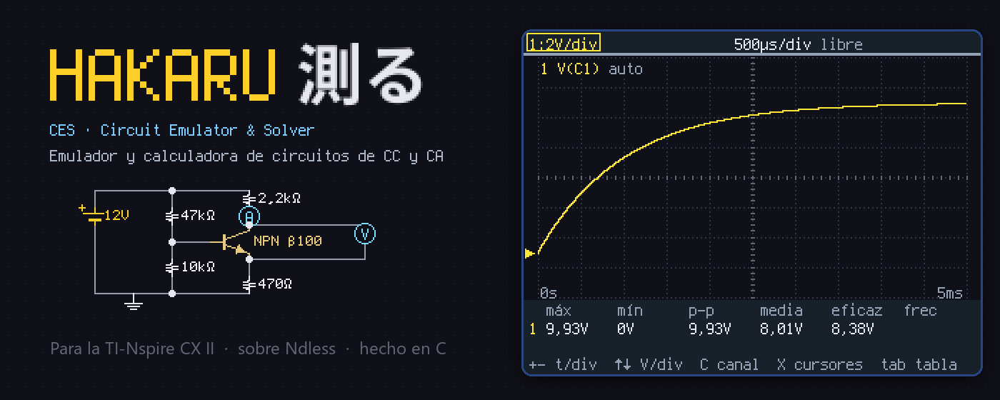
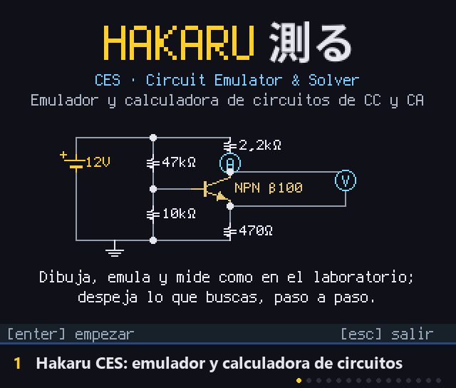
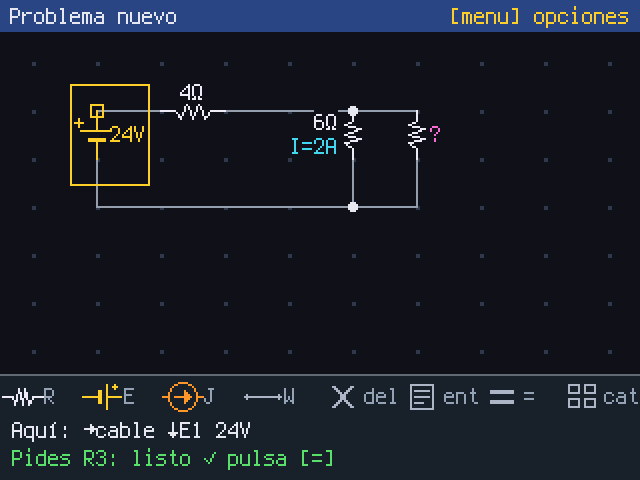
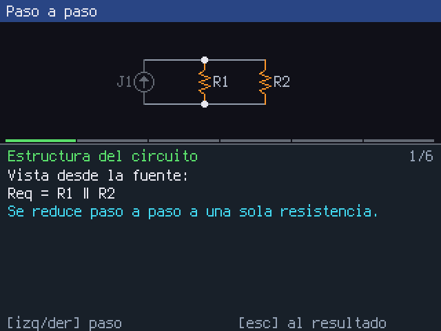
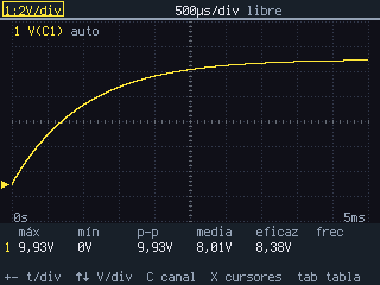
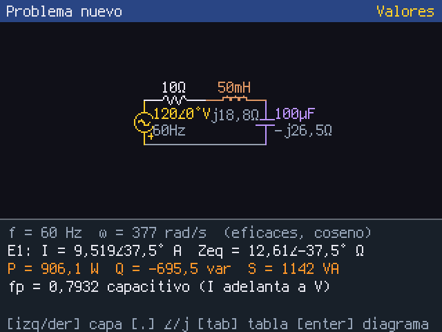
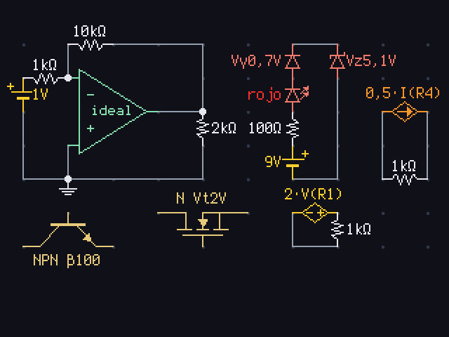
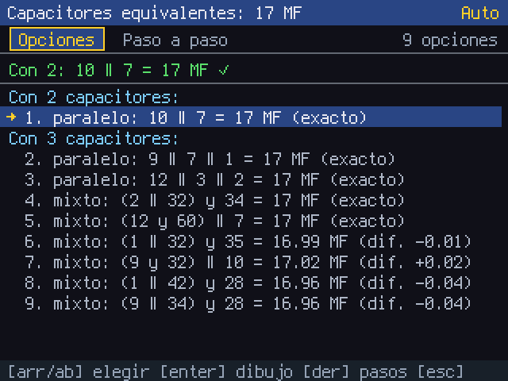
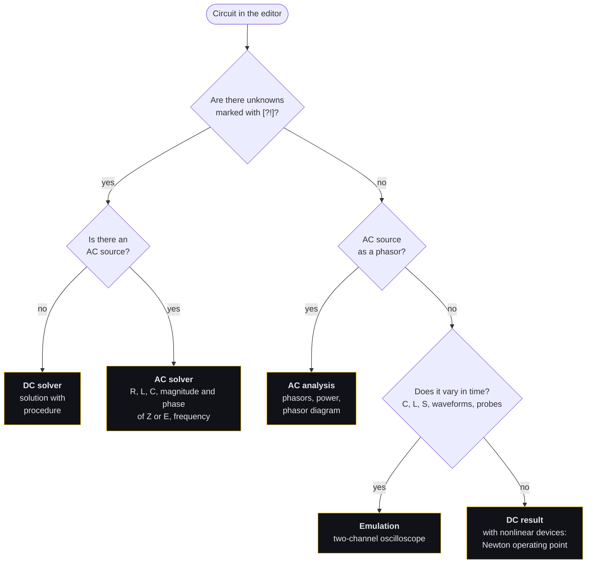
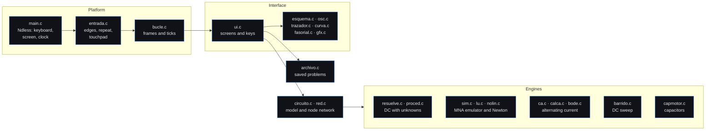

<p align="center">
  
</p>

<p align="center">
  
  
  
  
  <a href="LICENSE"></a>
</p>

<p align="center">
  <a href="README.md"></a>
  <a href="README.en.md"></a>
  <a href="README.zh-CN.md"></a>
  <a href="https://github.com/Eliam4510/hakaru-ces/releases/latest"></a>
  
  
  
</p>

<p align="center">
  <b>Circuit emulator and solver for direct and alternating current on the TI-Nspire CX II.</b>
</p>

<p align="center">
  <a href="#installation">Installation</a> ·
  <a href="docs/MANUAL.md">Manual</a> ·
  <a href="docs/COMPILAR.md">Building</a> ·
  <a href="docs/DESIGN.md">Design</a> ·
  <a href="docs/HOJA_DE_RUTA.md">Roadmap</a>
</p>

<p align="center">
  
</p>

## Overview

Hakaru CES is a native program for the TI-Nspire CX II and CX II CAS
graphing calculators, running on [Ndless](https://ndless.me/). Its name
combines *hakaru* (測る, "to measure" in Japanese) and the acronym CES,
*Circuit Emulator & Solver*. It brings a circuit editor and several analysis
engines to the calculator, with an approach similar to NI Multisim adapted to
a 320 × 240 pixel screen:

- solution of direct-current circuits with unknowns, together with the
  step-by-step procedure;
- time-domain emulation by modified nodal analysis (MNA), with a two-channel
  oscilloscope;
- sinusoidal steady-state analysis: phasors, power, phasor diagram,
  Thévenin and Norton equivalents, a Bode plotter and an AC solver;
- operating-point computation by Newton's method with diodes, operational
  amplifiers and transistors, and DC sweeps.

The user interface and the detailed documentation are in Spanish.

## Features

<table>
  <tr>
    <td width="33%" align="center"></td>
    <td width="33%" align="center"></td>
    <td width="33%" align="center"></td>
  </tr>
  <tr>
    <td valign="top"><b>Circuit editor</b><br>Grid-based editing: each component is placed with its key followed by an arrow. It includes a component palette, undo and redo, copy and paste, arithmetic expressions in the input fields and storage of saved problems.</td>
    <td valign="top"><b>Solution with procedure</b><br>The values marked with <code>[?!]</code> (a resistor, a source, the internal resistance of a battery) are solved with the complete procedure: series-parallel reduction, Ohm's law or Kirchhoff's laws, with results as exact fractions.</td>
    <td valign="top"><b>Time-domain emulation</b><br>Capacitors, inductors, timed switches and sources with waveforms. Two-channel oscilloscope with cursors, trigger and measurements, plus a table of energies and natural response.</td>
  </tr>
  <tr>
    <td width="33%" align="center"></td>
    <td width="33%" align="center"></td>
    <td width="33%" align="center"></td>
  </tr>
  <tr>
    <td valign="top"><b>Alternating current</b><br>Voltage and current phasors, active and reactive power with the Boucherot and Tellegen balances, phasor diagram, Bode plotter and an AC solver that finds R, L, C, the phase or the frequency.</td>
    <td valign="top"><b>Semiconductors and amplifiers</b><br>Diodes, zener diodes, LEDs, controlled sources, operational amplifier, BJT and MOSFET: Newton operating point, DC sweep, small-signal analysis and characteristic curves of each device.</td>
    <td valign="top"><b>Equivalent capacitors</b><br>Determines how to replace a capacitor (for example, the start capacitor of a single-phase motor) with the ones available in stock: one, two or three, in series, in parallel or in a mixed arrangement, with the procedure and the wiring diagram.</td>
  </tr>
</table>

The **Aprende** (Learn) module contains 13 lessons with theory, 40 worked
examples and 42 model circuits ready to emulate, as well as a practice mode
that hides the answers.

<details>
<summary><b>Available components</b></summary>

| Family | Components |
|---|---|
| Sources | voltage (ideal or real, with internal resistance) and current; DC, AC (phasor) or with a waveform: sine, square, triangle and pulse |
| Passive | resistor, capacitor, inductor, impedance Z, timed switch |
| Instruments | voltmeter and ammeter (ideal or with internal resistance), wattmeter, oscilloscope probes |
| Diodes | ideal, with Vγ, exponential, 1N4148, 1N4007, zener, LED in six colours |
| Active | controlled sources (all four), operational amplifier (ideal or real, with saturation), NPN/PNP BJT with Early effect, N/P-channel MOSFET |

</details>

## Choice of analysis

The `[=]` key selects the type of analysis from the contents of the circuit:



Other keys open the complementary analyses: `[B]` the Bode plot, `[I]` the
DC sweep, `[P]` the operating point and `[T]` the Thévenin and Norton
equivalents.

## Verification

| 352 164 | 42 | 40 | 13 | 3 |
|:-:|:-:|:-:|:-:|:-:|
| test-harness checks, no failures | model circuits | worked examples with answer key | lessons | independent oracles |

The whole program also builds for the PC, where a test harness drives it
through key scripts: it checks the calculation engines, exports every screen
as an image and subjects the interface to millions of random key presses.
The emulator, the AC analysis and the operating point are also cross-checked
against reference simulators written independently in Python (numpy, SciPy,
mpmath): 98 of 98, 174 of 174 and 260 of 260 random networks agree.

## Installation

1. The calculator (TI-Nspire CX II or CX II CAS) must have
   [Ndless](https://ndless.me/) installed and active.
2. Download `hakaru_ces.tns` from the
   [latest release](https://github.com/Eliam4510/hakaru-ces/releases/latest)
   and copy it to any folder on the calculator with TI Connect CE or
   TI-Nspire Link.
3. Open the file on the calculator and choose «Taller» (Workshop) >
   «Problema nuevo» (New problem).

The program stores its files in the same folder as the `.tns`: `ces_01.tns`
to `ces_20.tns` (saved problems), `ces_sesion.tns` (the editor circuit on
exit) and `ces_controles.tns` (keyboard and touchpad settings).

## Basic usage

1. In **Taller > Problema nuevo**, the cursor moves with the arrow keys.
2. Each component is placed with **its key followed by an arrow**: `[E]`
   `[→]` places a source pointing right, `[R]` `[↓]` a resistor pointing
   down and `[W]` draws wire until `[esc]` is pressed. The `[catalog]` key
   opens the full palette.
3. In each element's **form**, a number is **known data**, `[?!]` marks an
   **unknown** and `[del]` leaves the value undetermined. Unit prefixes are
   typed after the number (`4.7` `[K]` = 4.7 kΩ) and expressions such as
   `1÷(1÷4k+1÷6k)` are accepted.
4. `[=]` solves, emulates or analyses. In the result, `[left/right]` changes
   the diagram layer, `[tab]` opens the table and `[enter]` the procedure.
5. `[ctrl]` `[S]` saves the problem.

The complete reference of keys and screens is in the
[manual](docs/MANUAL.md) (in Spanish).

## Building and testing

Requires the [Ndless SDK](https://github.com/ndless-nspire/Ndless) on Linux
or WSL:

```bash
make                    # hakaru_ces.tns, with the SDK on the PATH
sh build_tns.sh         # same, with the SDK in /opt/Ndless
sh build_host.sh        # test harness on the PC; leaves a capture of every screen in out/
```

Setting up the environment, running the tests by parts, the monkey test, the
input-layer regression and the oracles are described in
[docs/COMPILAR.md](docs/COMPILAR.md) (in Spanish).

## Architecture



<details>
<summary><b>Contents of each file</b></summary>

| Files | Contents |
|---|---|
| `main.c`, `bucle.c`, `entrada.c` | Start-up, frame loop and input layer (keys, repeat, touchpad, power) |
| `ui.c`, `esquema.c`, `gfx.c`, `font*.c`, `kanji_img.c` | Interface: screens, circuit drawing, graphics and typography |
| `circuito.c`, `red.c`, `tipos.c` | Circuit model and its extraction into a node network |
| `resuelve.c`, `algebra.c`, `arbol.c`, `proced.c`, `pasos.c`, `numfmt.c` | DC engine with unknowns and step-by-step procedure |
| `sim.c`, `lu.c`, `ondas.c`, `nolin.c`, `osc.c` | Time-domain emulator (MNA), waveforms, Newton's method and oscilloscope |
| `ca.c`, `cx.c`, `luc.c`, `calca.c`, `bode.c`, `trazador.c`, `fasorial.c` | Alternating current: phasors, AC solver, Bode and phasor diagram |
| `barrido.c`, `curva.c` | DC sweep and its curves |
| `biblioteca.c`, `ejemplos.c`, `lecciones.c` | The 42 model circuits, the 40 examples and the 13 lessons |
| `capmotor.c`, `capmotor_dib.c`, `capeq_texto.c` | Equivalent capacitors: calculation, diagram, theory and examples |
| `archivo.c` | Saved problems, session and settings (`CESP` format) |
| `banco.c`, `turbo.c`, `cf_arm.c` | Timing benchmark, experimental overclock (disabled) and fast ARM floating point |
| `host_test.c`, `test_*.inc` | Test harness for the PC |
| `herramientas/` | Python oracles and generators (fonts, kanji, tables and the images of this document) |
| `docs/` | Manual, building, design, roadmap and history |

</details>

## Documentation

The detailed documentation is written in Spanish.

| Document | Contents |
|---|---|
| [Manual](docs/MANUAL.md) | Use of the program, screen by screen, with every key |
| [Building and testing](docs/COMPILAR.md) | Environment, building, test harness, monkey test and oracles |
| [Design](docs/DESIGN.md) | Architecture, engines, decisions and verification of each stage |
| [Roadmap](docs/HOJA_DE_RUTA.md) | Current status, pending work and pending tests on the calculator |
| [History](docs/HISTORIAL.md) | Versions, from ElectroFock to Hakaru CES 4.0 |

## License and credits

Hakaru CES is the work of **Eliam Mojardin Ibarra** and is distributed under
the [MIT](LICENSE) license.

The text uses the Terminus font (© Dimitar Toshkov Zhekov) and the kanji on
the title screen uses Noto Sans JP (© Adobe), both under the SIL Open Font
License 1.1. The program is built with the Ndless SDK. TI-Nspire is a
trademark of Texas Instruments; this project is not affiliated with that
company. See [AVISOS.md](AVISOS.md).
