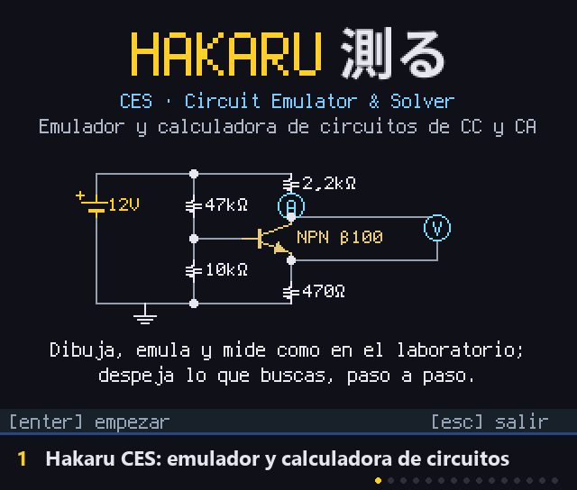
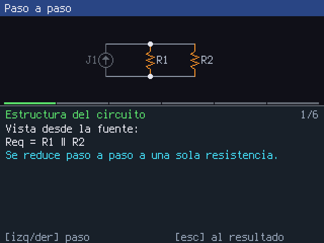
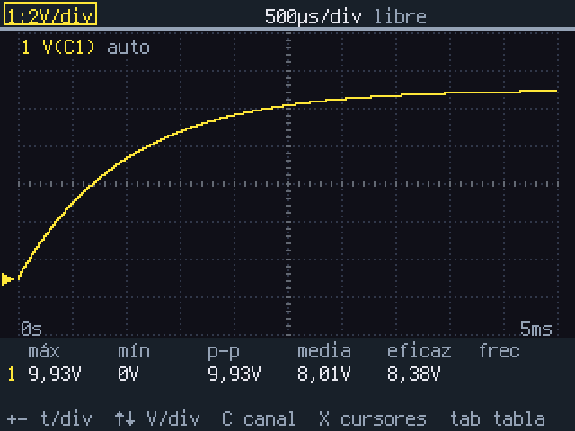
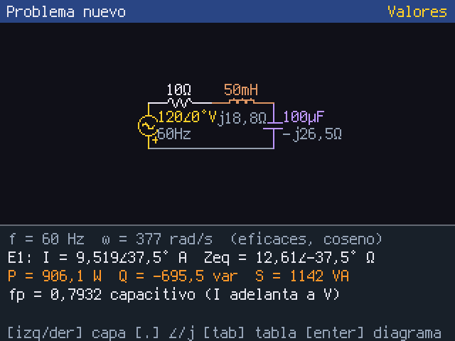
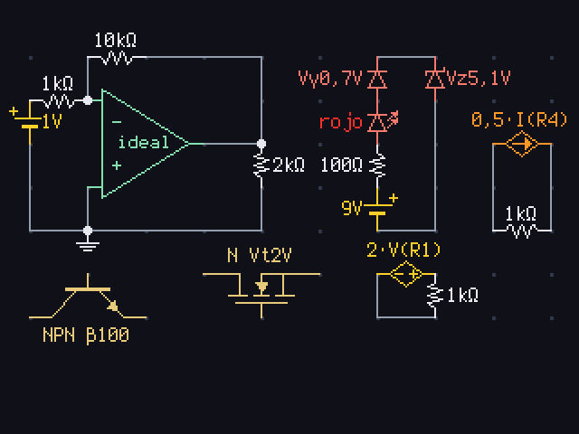
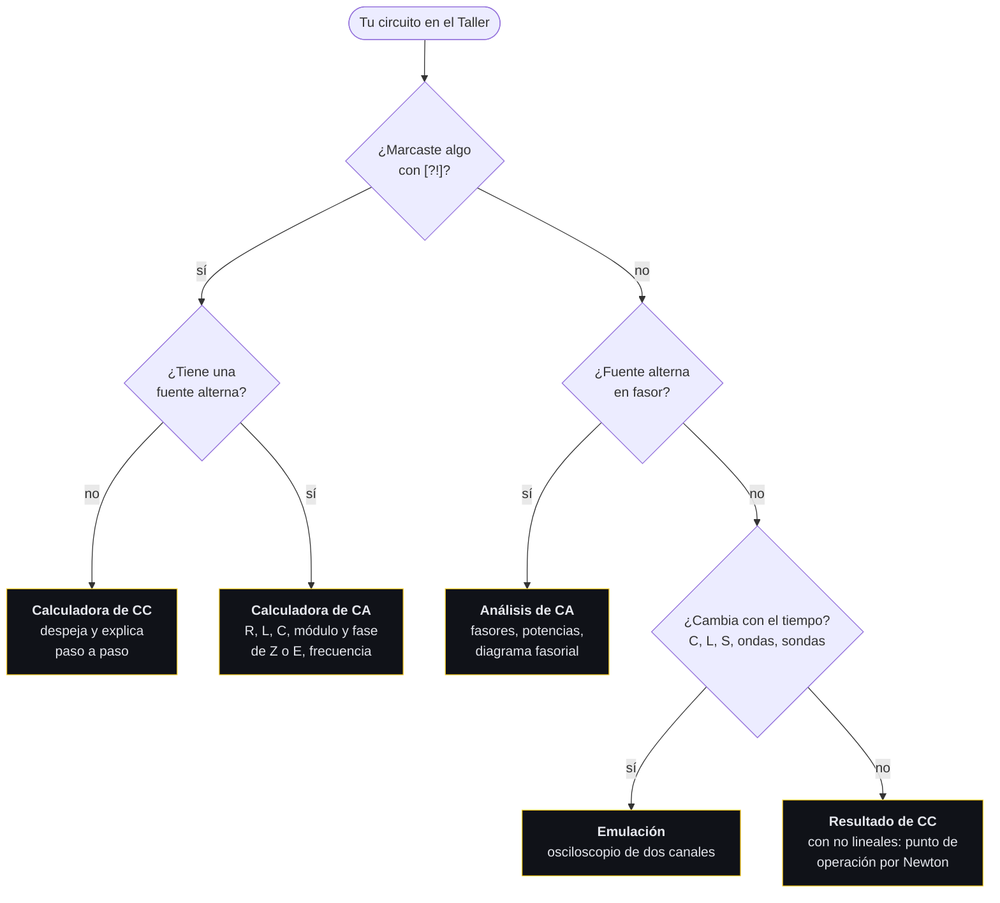
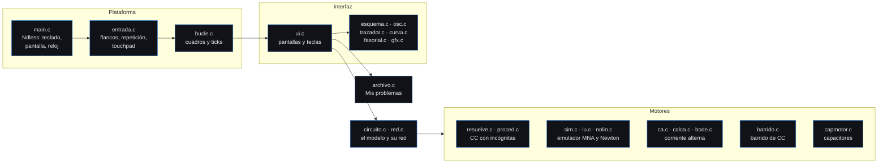

<p align="center">
  
</p>

<p align="center">
  
  
  
  
  <a href="LICENSE"></a>
</p>

<p align="center">
  <a href="https://github.com/Eliam4510/hakaru-ces/releases/latest"></a>
  <a href="https://github.com/Eliam4510/hakaru-ces/releases"></a>
  
  
  
  <a href="https://github.com/Eliam4510/hakaru-ces/stargazers"></a>
</p>

<p align="center">
  <b>Emulador y calculadora de circuitos de CC y CA para la TI-Nspire CX II.</b><br>
  Dibuja el circuito en la calculadora y Hakaru lo <b>emula</b>, lo <b>analiza en alterna</b>,<br>
  encuentra su <b>punto de operación</b> o <b>despeja</b> lo que buscas, paso a paso.
</p>

<p align="center">
  <a href="#-instalar-en-la-calculadora"><b>Instalar</b></a> ·
  <a href="docs/MANUAL.md"><b>Manual</b></a> ·
  <a href="docs/COMPILAR.md"><b>Compilar</b></a> ·
  <a href="docs/DESIGN.md"><b>Diseño</b></a> ·
  <a href="docs/HOJA_DE_RUTA.md"><b>Hoja de ruta</b></a> ·
  <a href="#-in-english"><b>English</b></a>
</p>

<p align="center">
  
</p>

*Hakaru* (測る) quiere decir «medir» en japonés; **CES** es la sigla de
*Circuit Emulator & Solver*. Es un programa nativo para la calculadora, que
corre sobre [Ndless](https://ndless.me/), y funciona como un pequeño
laboratorio de electrónica al estilo de NI Multisim, en 320 × 240 píxeles.

## ✨ Qué hace

<table>
  <tr>
    <td width="33%" align="center"></td>
    <td width="33%" align="center"></td>
    <td width="33%" align="center"></td>
  </tr>
  <tr>
    <td valign="top"><b>✏️ Dibuja</b><br>Un editor sobre una rejilla: <b>tecla + flecha</b> pone cada componente. Paleta, deshacer y rehacer, copiar y pegar, cuentas en los campos y «Mis problemas».</td>
    <td valign="top"><b>🧮 Despeja y explica</b><br>Marca con <code>[?!]</code> lo que buscas (una R, una fuente, la r interna de una pila…) y obtén el <b>procedimiento de la pizarra</b>: reducción, ley de Ohm, Kirchhoff, fracciones exactas.</td>
    <td valign="top"><b>📈 Emula en el tiempo</b><br>Condensadores, bobinas, interruptores y fuentes con forma. Un <b>osciloscopio</b> de dos canales con cursores, disparo y medidas; tabla de energías y respuesta natural.</td>
  </tr>
  <tr>
    <td width="33%" align="center"></td>
    <td width="33%" align="center"></td>
    <td width="33%" align="center"></td>
  </tr>
  <tr>
    <td valign="top"><b>〰️ Corriente alterna</b><br>Fasores, potencias (Boucherot y Tellegen), <b>diagrama fasorial</b>, Thévenin y Norton, <b>trazador de Bode</b> y una <b>calculadora de CA</b> que despeja R, L, C, la fase o la frecuencia.</td>
    <td valign="top"><b>🔺 Semiconductores</b><br>Diodos, zener, LED, fuentes controladas, el <b>amplificador operacional</b>, el <b>BJT</b> y el <b>MOSFET</b>: punto de operación por Newton, barrido de CC y curvas de cada componente.</td>
    <td valign="top"><b>🔋 Capacitores equivalentes</b><br>¿Se quemó el capacitor de un motor? Con los de la bodega busca cómo armarlo: uno, dos o tres, en serie, en paralelo o mixtos, con el paso a paso y el <b>dibujo del cableado</b>.</td>
  </tr>
</table>

Y además **Aprende**: 13 lecciones con teoría, **40 ejemplos** resueltos y
**42 circuitos modelo** listos para emular, con un **modo práctica** que
tapa las respuestas para que las escribas tú.

<details>
<summary><b>🔌 Todos los componentes</b></summary>

| Familia | Componentes |
|---|---|
| Fuentes | de tensión (ideal o real, con su r) y de corriente; continuas, alternas (fasor) o con forma: senoidal, cuadrada, triangular, pulso |
| Pasivos | resistencia · condensador · bobina · impedancia Z · interruptor temporizado |
| Instrumentos | voltímetro · amperímetro (ideales o con R interna) · vatímetro · sondas del osciloscopio |
| Diodos | ideal · con Vγ · exponencial · 1N4148 · 1N4007 · zener · LED (seis colores, se enciende con su corriente) |
| Activos | fuentes controladas (las cuatro) · amplificador operacional (ideal o real, con saturación) · BJT NPN/PNP (con Early) · MOSFET de canal N/P |

</details>

## ⚡ Una tecla, cuatro motores

La tecla `[=]` mira el circuito y elige qué hacer:



Y con una tecla más: `[B]` traza el **Bode**, `[I]` hace un **barrido de
CC**, `[P]` da el **punto de operación** y `[T]`, **Thévenin y Norton**.

## 📊 En números

| 352 164 | 42 | 40 | 13 | 3 |
|:-:|:-:|:-:|:-:|:-:|
| comprobaciones del arnés, **0 fallos** | circuitos modelo para emular | ejemplos resueltos con clave | lecciones | oráculos independientes en Python |

Todo el programa se compila también para el PC y un **arnés de pruebas** lo
conduce entero con guiones de teclas: comprueba los motores, vuelca a imagen
cada pantalla y deja a un «mono» pulsar millones de teclas al azar. El
emulador, la CA y el punto de operación se comparan además con **simuladores
de referencia escritos aparte** (numpy, SciPy, mpmath): 98 de 98, 174 de 174
y 260 de 260 redes al azar iguales. Cuánto código hay y en qué lenguajes lo
dice GitHub en la barra **Languages** de este repositorio.

La calculadora no tiene unidad de coma flotante, así que el programa se
**optimizó** midiendo un perfil fiel del procesador ARM y quitando trabajo
sin cambiar ni un bit de los resultados (con una división, una raíz y unas
comparaciones de `double` propias, exactas y mucho más rápidas):

<p align="center">
  <picture>
    <source media="(prefers-color-scheme: dark)" srcset="docs/img/grafica_optimizacion_oscuro.svg">
    
  </picture>
</p>

<details>
<summary>Los números de la gráfica</summary>

| Carga en la calculadora | Trabajo que se quitó |
|---|---:|
| Bode, pantalla quieta | −89 % |
| Osciloscopio (dibujo) | −79 % |
| Ejemplo de CC resuelto | −67 % |
| Punto de CA | −60 % |
| Pantalla de CA | −56 % |
| Peor caso de CC | −53 % |
| Bode de un RLC | −48 % |
| Editor (dibujo) | −47 % |
| Paso del puente con 1N4007 | −26 % |
| Paso del emulador | −15 % |

Medido en un perfil del ARM926 de la calculadora (QEMU con un modelo de
ciclos calibrado con el banco de tiempos real). Detalles en
[DESIGN.md §23](docs/DESIGN.md#23-la-optimización-rev9).

</details>

## 📥 Instalar en la calculadora

1. La calculadora (**TI-Nspire CX II** o **CX II CAS**) necesita
   [**Ndless**](https://ndless.me/) instalado y activo.
2. Descarga **`hakaru_ces.tns`** de la
   [última versión](https://github.com/Eliam4510/hakaru-ces/releases/latest)
   y cópialo a cualquier carpeta de la calculadora con TI Connect CE o
   TI-Nspire Link.
3. Ábrelo desde la calculadora. La primera vez: Taller > «Problema nuevo».

El programa guarda sus archivos junto al `.tns`: `ces_01.tns` … `ces_20.tns`
(Mis problemas), `ces_sesion.tns` (el circuito del editor al salir) y
`ces_controles.tns` (los ajustes de las teclas y el touchpad).

## 🚀 Uso rápido

1. **Taller > Problema nuevo.** Mueve el cursor (el cuadrito amarillo) con
   las flechas.
2. Pon componentes con **tecla + flecha**: `[E]` `[→]` es una fuente hacia
   la derecha, `[R]` `[↓]` una resistencia hacia abajo, `[W]` tiende cable
   hasta `[esc]`. El libro (`[catálogo]`) abre la paleta con todo.
3. En la **ficha** de cada elemento: un número es un **dato**, `[?!]` es
   **lo que buscas** y `[del]` es «no se sabe». Los prefijos van detrás:
   `4.7` `[K]` = 4,7 kΩ. También acepta cuentas: `1÷(1÷4k+1÷6k)`.
4. `[=]` resuelve, emula o analiza. En el resultado, `[izq/der]` cambia las
   capas del dibujo, `[tab]` abre la tabla y `[enter]` el procedimiento.
5. `[ctrl]` `[S]` guarda en Mis problemas.

Todas las teclas, pantalla por pantalla: **[docs/MANUAL.md](docs/MANUAL.md)**.

## 🛠️ Compilar y probar

Con el [Ndless SDK](https://github.com/ndless-nspire/Ndless) (en Linux o WSL):

```bash
make                    # hakaru_ces.tns, con el SDK en el PATH
sh build_tns.sh         # lo mismo, con el SDK en /opt/Ndless
sh build_host.sh        # el arnés en el PC: las pruebas y una captura de cada pantalla en out/
```

Cómo preparar el entorno, las pruebas por partes, el mono, la regresión por
la capa de entrada y los oráculos: **[docs/COMPILAR.md](docs/COMPILAR.md)**.

## 🧭 Arquitectura



<details>
<summary><b>📁 Qué hay en cada archivo</b></summary>

| Archivos | Qué son |
|---|---|
| `main.c`, `bucle.c`, `entrada.c` | El arranque, el bucle de cuadros y la capa de entrada (teclas, repetición, touchpad, energía) |
| `ui.c`, `esquema.c`, `gfx.c`, `font*.c`, `kanji_img.c` | La interfaz: pantallas, dibujo del circuito, gráficos y tipografía |
| `circuito.c`, `red.c`, `tipos.c` | El modelo del circuito y su extracción a una red de nodos |
| `resuelve.c`, `algebra.c`, `arbol.c`, `proced.c`, `pasos.c`, `numfmt.c` | El motor de CC con incógnitas y el procedimiento paso a paso |
| `sim.c`, `lu.c`, `ondas.c`, `nolin.c`, `osc.c` | El emulador en el tiempo (MNA), las formas de onda, Newton y el osciloscopio |
| `ca.c`, `cx.c`, `luc.c`, `calca.c`, `bode.c`, `trazador.c`, `fasorial.c` | La corriente alterna: fasores, calculadora de CA, Bode y diagrama fasorial |
| `barrido.c`, `curva.c` | El barrido de CC y sus curvas |
| `biblioteca.c`, `ejemplos.c`, `lecciones.c` | Los 42 circuitos modelo, los 40 ejemplos y las 13 lecciones |
| `capmotor.c`, `capmotor_dib.c`, `capeq_texto.c` | Capacitores equivalentes: cálculo, dibujo, teoría y ejemplos |
| `archivo.c` | Mis problemas, la sesión y los ajustes (formato `CESP`) |
| `banco.c`, `turbo.c`, `cf_arm.c` | El banco de tiempos, el turbo experimental (apagado) y la coma flotante rápida del ARM |
| `host_test.c`, `test_*.inc` | El arnés de pruebas para el PC |
| `herramientas/` | Los oráculos en Python y los generadores (fuentes, kanji, tablas, imágenes de este README) |
| `docs/` | Manual, compilación, diseño, hoja de ruta e historial |

</details>

## 📚 Documentación

| | |
|---|---|
| 📖 [**Manual**](docs/MANUAL.md) | Cómo se usa, pantalla por pantalla, con todas las teclas |
| 🛠️ [**Compilar y probar**](docs/COMPILAR.md) | El entorno, la compilación, el arnés, el mono y los oráculos |
| 🧠 [**Diseño**](docs/DESIGN.md) | La arquitectura, los motores, las decisiones y cómo se verificó cada etapa |
| 🗺️ [**Hoja de ruta**](docs/HOJA_DE_RUTA.md) | Lo hecho, lo que sigue y lo que falta probar en la calculadora |
| 🕰️ [**Historial**](docs/HISTORIAL.md) | Las versiones, de ElectroFock a Hakaru CES 4.0 |

## 🕰️ Historia

El proyecto empezó en septiembre de 2026 como una calculadora de circuitos de
corriente continua para estudiar (primero con el nombre provisional
«Electroestatica» y luego **ElectroFock**) y fue creciendo por etapas: el
emulador en el tiempo, la corriente alterna, los semiconductores y los
amplificadores. Al cerrar la Etapa 4 tomó su nombre actual, **Hakaru CES**.
Después llegaron la optimización, los capacitores equivalentes y esta
publicación. Lo siguiente, en la [hoja de ruta](docs/HOJA_DE_RUTA.md):
transformadores, trifásica y emulación en vivo.

## 📄 Licencia y créditos

Hakaru CES es de **Eliam Mojardin Ibarra**, con licencia [MIT](LICENSE).

El texto usa la fuente Terminus (© Dimitar Toshkov Zhekov) y el kanji de la
portada, Noto Sans JP (© Adobe), ambas con la SIL Open Font License 1.1. Se
compila con el Ndless SDK. TI-Nspire es una marca de Texas Instruments; este
proyecto no está afiliado a ella. Ver [AVISOS.md](AVISOS.md).

---

## 🌐 In English

<details>
<summary><b>Hakaru CES in a nutshell</b></summary>

**Hakaru CES** (*hakaru*, 測る, means "to measure" in Japanese; CES stands for
*Circuit Emulator & Solver*) is a native circuit emulator and calculator for
the **TI-Nspire CX II / CX II CAS** graphing calculator, running on
[Ndless](https://ndless.me/). Think of a tiny NI Multisim on a 320×240 screen:

- draw a circuit on a grid editor (key + arrow places each part);
- **solve** DC circuits for any unknown (a resistor, a source, a battery's
  internal resistance…) with a classroom-style **step-by-step procedure**;
- **emulate** them in time (MNA engine) with a two-channel **oscilloscope**;
- **AC analysis** with phasors, power, phasor diagrams, Thévenin/Norton, a
  **Bode plotter** and an AC solver;
- **diodes, zeners, LEDs, controlled sources, op-amps, BJTs and MOSFETs**,
  with a Newton operating point, DC sweeps and device curves;
- a tool to build an **equivalent capacitor** from the ones in stock;
- 13 lessons, 40 worked examples and 42 model circuits.

Everything also compiles for the PC as a **test harness** (352 164 checks,
0 failures) and is cross-checked against independent reference simulators
written in Python. The user interface and documentation are in Spanish.
Install: put `hakaru_ces.tns` from the
[latest release](https://github.com/Eliam4510/hakaru-ces/releases/latest) on a
calculator with Ndless. Build: `make` with the Ndless SDK. License: MIT.

</details>
