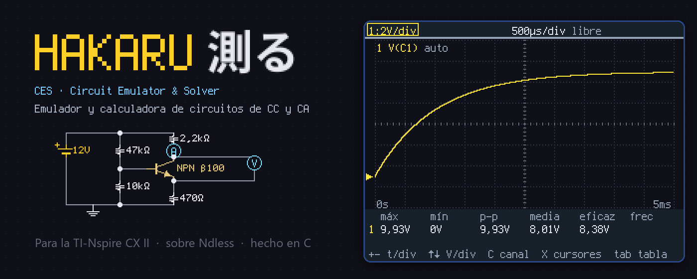
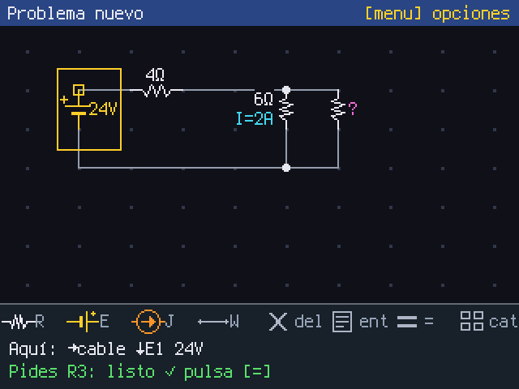
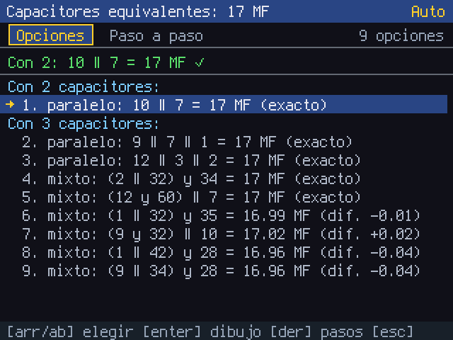
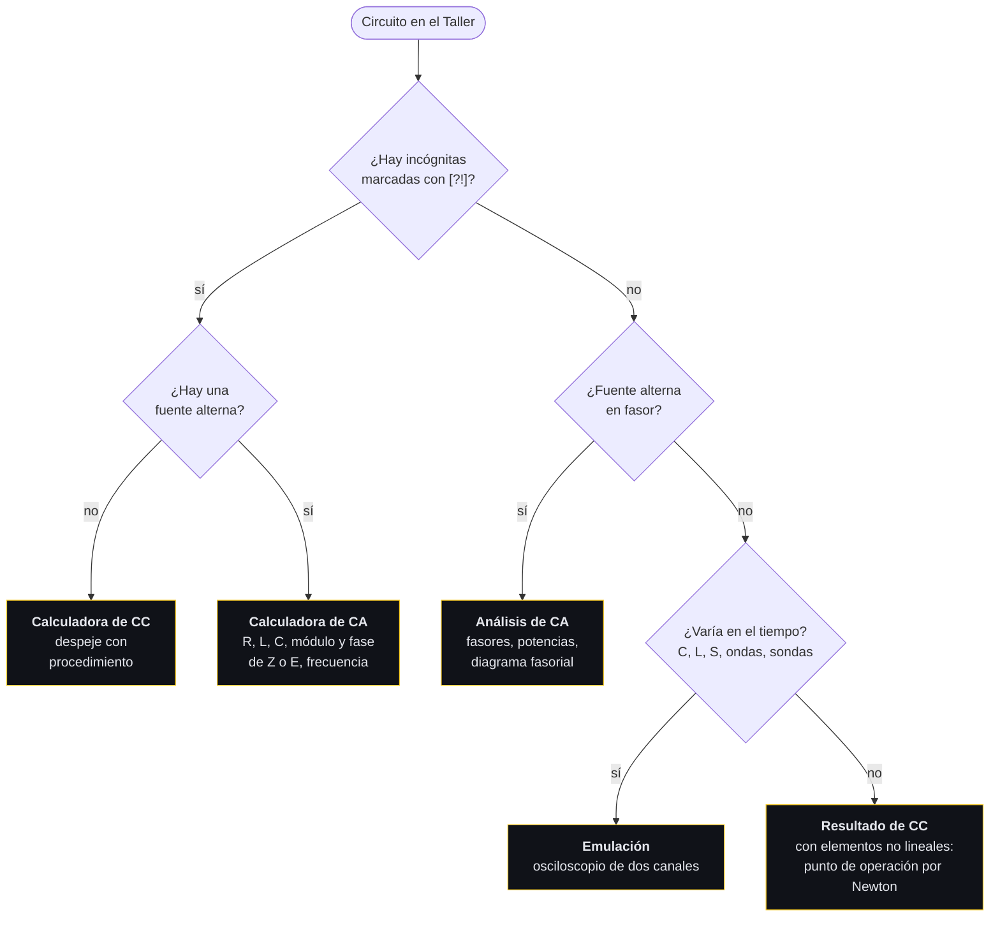
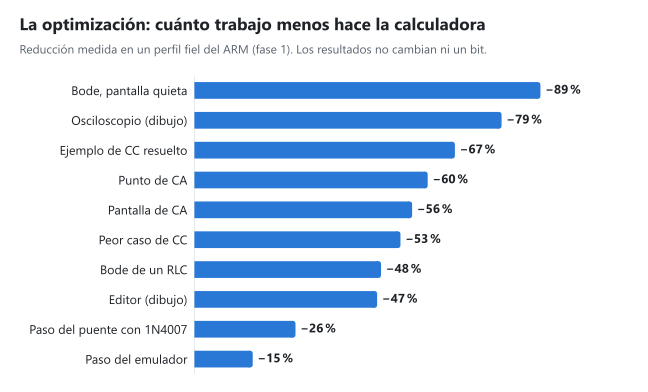
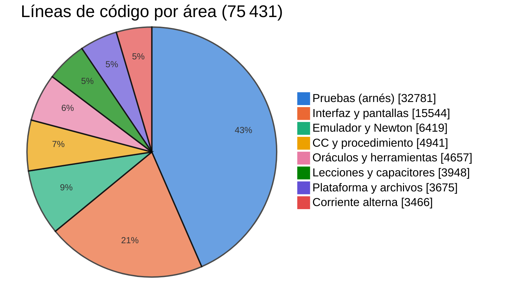
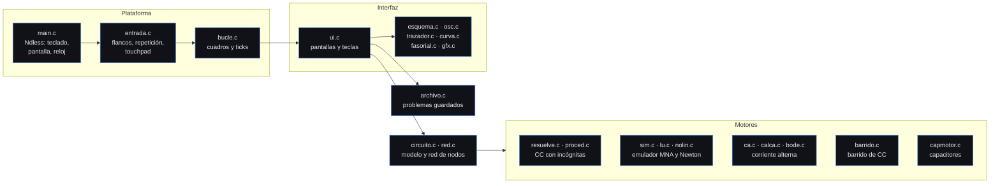

<p align="center">
  
</p>

<p align="center">
  
  
  
  
  <a href="LICENSE"></a>
</p>

<p align="center">
  <a href="https://github.com/Eliam4510/hakaru-ces/releases/latest"></a>
  
  <a href="#código"></a>
  
  
</p>

<p align="center">
  <b>Emulador y calculadora de circuitos de corriente continua y alterna para la TI-Nspire CX II.</b>
</p>

<p align="center">
  <a href="#instalación">Instalación</a> ·
  <a href="docs/MANUAL.md">Manual</a> ·
  <a href="docs/COMPILAR.md">Compilación</a> ·
  <a href="docs/DESIGN.md">Diseño</a> ·
  <a href="docs/HOJA_DE_RUTA.md">Hoja de ruta</a> ·
  <a href="#english-summary">English</a>
</p>

<p align="center">
  
</p>

## Descripción

Hakaru CES es un programa nativo para las calculadoras TI-Nspire CX II y CX II
CAS que se ejecuta sobre [Ndless](https://ndless.me/). El nombre combina
*hakaru* (測る, «medir» en japonés) y la sigla CES, *Circuit Emulator &
Solver*. Reúne en la calculadora un editor de circuitos y varios motores de
análisis, con un planteamiento similar al de NI Multisim adaptado a una
pantalla de 320 × 240 píxeles:

- resolución de circuitos de corriente continua con incógnitas, acompañada
  del procedimiento paso a paso;
- emulación en el dominio del tiempo mediante análisis nodal modificado
  (MNA), con un osciloscopio de dos canales;
- análisis en régimen sinusoidal permanente: fasores, potencias, diagrama
  fasorial, equivalentes de Thévenin y Norton, trazador de Bode y una
  calculadora de CA;
- cálculo del punto de operación por el método de Newton con diodos,
  amplificadores operacionales y transistores, y barridos de CC.

## Funciones

<table>
  <tr>
    <td width="33%" align="center"></td>
    <td width="33%" align="center"></td>
    <td width="33%" align="center"></td>
  </tr>
  <tr>
    <td valign="top"><b>Editor de circuitos</b><br>Edición sobre una rejilla: cada componente se coloca con su tecla y una flecha. Incluye paleta de componentes, deshacer y rehacer, copiar y pegar, operaciones aritméticas en los campos y almacenamiento de problemas.</td>
    <td valign="top"><b>Resolución con procedimiento</b><br>Los valores marcados con <code>[?!]</code> (una resistencia, una fuente, la resistencia interna de una pila) se despejan con el procedimiento completo: reducción serie-paralelo, ley de Ohm o leyes de Kirchhoff, con resultados en fracción exacta.</td>
    <td valign="top"><b>Emulación en el tiempo</b><br>Condensadores, bobinas, interruptores temporizados y fuentes con forma de onda. Osciloscopio de dos canales con cursores, disparo y medidas, y tabla de energías y respuesta natural.</td>
  </tr>
  <tr>
    <td width="33%" align="center"></td>
    <td width="33%" align="center"></td>
    <td width="33%" align="center"></td>
  </tr>
  <tr>
    <td valign="top"><b>Corriente alterna</b><br>Fasores de tensión y corriente, potencias activa y reactiva con los balances de Boucherot y Tellegen, diagrama fasorial, trazador de Bode y una calculadora de CA que despeja R, L, C, la fase o la frecuencia.</td>
    <td valign="top"><b>Semiconductores y amplificadores</b><br>Diodos, zener, LED, fuentes controladas, amplificador operacional, BJT y MOSFET: punto de operación por Newton, barrido de CC, pequeña señal y curvas características de cada componente.</td>
    <td valign="top"><b>Capacitores equivalentes</b><br>Determina cómo sustituir un capacitor (por ejemplo, el de arranque de un motor monofásico) con los disponibles en bodega: uno, dos o tres, en serie, en paralelo o en arreglo mixto, con el procedimiento y el diagrama de conexión.</td>
  </tr>
</table>

El módulo **Aprende** contiene 13 lecciones con teoría, 40 ejemplos
resueltos y 42 circuitos modelo listos para emular, además de un modo de
práctica que oculta las respuestas.

<details>
<summary><b>Componentes disponibles</b></summary>

| Familia | Componentes |
|---|---|
| Fuentes | de tensión (ideal o real, con resistencia interna) y de corriente; continuas, alternas (fasor) o con forma de onda: senoidal, cuadrada, triangular y pulso |
| Pasivos | resistencia, condensador, bobina, impedancia Z, interruptor temporizado |
| Instrumentos | voltímetro y amperímetro (ideales o con resistencia interna), vatímetro, sondas del osciloscopio |
| Diodos | ideal, con Vγ, exponencial, 1N4148, 1N4007, zener, LED de seis colores |
| Activos | fuentes controladas (las cuatro), amplificador operacional (ideal o real, con saturación), BJT NPN/PNP con efecto Early, MOSFET de canal N/P |

</details>

## Selección del análisis

La tecla `[=]` determina el tipo de análisis a partir del contenido del
circuito:



Otras teclas abren los análisis complementarios: `[B]` el diagrama de
Bode, `[I]` el barrido de CC, `[P]` el punto de operación y `[T]` los
equivalentes de Thévenin y Norton.

## Verificación

| 352 164 | 42 | 40 | 13 | 3 |
|:-:|:-:|:-:|:-:|:-:|
| comprobaciones del arnés, sin fallos | circuitos modelo | ejemplos resueltos con clave | lecciones | oráculos independientes |

El programa completo se compila también para el PC, donde un arnés de
pruebas lo conduce mediante guiones de teclas: verifica los motores de
cálculo, exporta cada pantalla a imagen y somete la interfaz a millones de
pulsaciones aleatorias. El emulador, el análisis de CA y el punto de
operación se contrastan además con simuladores de referencia escritos de
forma independiente en Python (numpy, SciPy, mpmath): 98 de 98, 174 de 174
y 260 de 260 redes aleatorias coinciden.

La calculadora no dispone de unidad de coma flotante. El programa se
optimizó a partir de un perfil fiel del procesador ARM, con rutinas propias
de división, raíz cuadrada y comparación de `double`, exactas y más
rápidas que las de la biblioteca, sin alterar ningún bit de los
resultados:

<p align="center">
  <picture>
    <source media="(prefers-color-scheme: dark)" srcset="docs/img/grafica_optimizacion_oscuro.svg">
    
  </picture>
</p>

<details>
<summary>Datos de la gráfica</summary>

| Carga en la calculadora | Reducción del trabajo |
|---|---:|
| Bode, pantalla en reposo | −89 % |
| Osciloscopio (dibujo) | −79 % |
| Ejemplo de CC resuelto | −67 % |
| Punto de CA | −60 % |
| Pantalla de CA | −56 % |
| Peor caso de CC | −53 % |
| Bode de un RLC | −48 % |
| Editor (dibujo) | −47 % |
| Paso del puente con 1N4007 | −26 % |
| Paso del emulador | −15 % |

Medido sobre un perfil del ARM926 de la calculadora (QEMU con un modelo de
ciclos calibrado con el banco de tiempos del equipo real). Detalles en
[DESIGN.md §23](docs/DESIGN.md#23-la-optimización-rev9).

</details>

## Código

<!-- ESTADISTICAS:INICIO -->



| Lenguaje | Archivos | Código | Comentarios | En blanco | Total |
|---|---:|---:|---:|---:|---:|
| C | 131 | 70 579 | 10 991 | 4 931 | 86 501 |
| Python | 12 | 4 657 | 901 | 600 | 6 158 |
| Shell | 7 | 149 | 74 | 7 | 230 |
| Makefile | 1 | 46 | 34 | 15 | 95 |
| **Total** | **151** | **75 431** | **12 000** | **5 553** | **92 984** |

Se cuentan los archivos del repositorio escritos a mano; los generados por las herramientas (3 archivos, 13 961 líneas: la fuente en mapa de bits, el kanji y las tablas de soluciones exactas) quedan aparte, como en la barra de lenguajes de GitHub. El recuento se actualiza en cada cambio con el workflow [Estadísticas del código](.github/workflows/estadisticas.yml) ([`herramientas/estadisticas_codigo.py`](herramientas/estadisticas_codigo.py)).

<!-- ESTADISTICAS:FIN -->

## Instalación

1. La calculadora (TI-Nspire CX II o CX II CAS) debe tener
   [Ndless](https://ndless.me/) instalado y activo.
2. Descargar `hakaru_ces.tns` de la
   [última versión](https://github.com/Eliam4510/hakaru-ces/releases/latest)
   y copiarlo a cualquier carpeta de la calculadora con TI Connect CE o
   TI-Nspire Link.
3. Abrir el archivo desde la calculadora y elegir Taller > «Problema nuevo».

El programa guarda sus archivos en la misma carpeta que el `.tns`:
`ces_01.tns` a `ces_20.tns` (problemas guardados), `ces_sesion.tns` (el
circuito del editor al salir) y `ces_controles.tns` (ajustes de teclado y
touchpad).

## Uso básico

1. En **Taller > Problema nuevo**, el cursor se desplaza con las flechas.
2. Cada componente se coloca con **su tecla y una flecha**: `[E]` `[→]`
   coloca una fuente orientada a la derecha, `[R]` `[↓]` una resistencia
   hacia abajo y `[W]` traza cable hasta pulsar `[esc]`. La tecla
   `[catálogo]` abre la paleta completa.
3. En la **ficha** de cada elemento, un número es un **dato**, `[?!]` marca
   una **incógnita** y `[del]` deja el valor como desconocido. Los prefijos
   se escriben después del número (`4.7` `[K]` = 4,7 kΩ) y se admiten
   expresiones como `1÷(1÷4k+1÷6k)`.
4. `[=]` resuelve, emula o analiza. En el resultado, `[izq/der]` cambia la
   capa del esquema, `[tab]` abre la tabla y `[enter]` el procedimiento.
5. `[ctrl]` `[S]` guarda el problema.

La referencia completa de teclas y pantallas está en el
[manual](docs/MANUAL.md).

## Compilación y pruebas

Requiere el [Ndless SDK](https://github.com/ndless-nspire/Ndless) en Linux o
WSL:

```bash
make                    # hakaru_ces.tns, con el SDK en el PATH
sh build_tns.sh         # equivalente, con el SDK en /opt/Ndless
sh build_host.sh        # arnés de pruebas en el PC; deja una captura de cada pantalla en out/
```

La preparación del entorno, las pruebas por partes, el mono, la regresión
por la capa de entrada y los oráculos se describen en
[docs/COMPILAR.md](docs/COMPILAR.md).

## Arquitectura



<details>
<summary><b>Contenido de cada archivo</b></summary>

| Archivos | Contenido |
|---|---|
| `main.c`, `bucle.c`, `entrada.c` | Arranque, bucle de cuadros y capa de entrada (teclas, repetición, touchpad, energía) |
| `ui.c`, `esquema.c`, `gfx.c`, `font*.c`, `kanji_img.c` | Interfaz: pantallas, dibujo del circuito, gráficos y tipografía |
| `circuito.c`, `red.c`, `tipos.c` | Modelo del circuito y su extracción a una red de nodos |
| `resuelve.c`, `algebra.c`, `arbol.c`, `proced.c`, `pasos.c`, `numfmt.c` | Motor de CC con incógnitas y procedimiento paso a paso |
| `sim.c`, `lu.c`, `ondas.c`, `nolin.c`, `osc.c` | Emulador en el tiempo (MNA), formas de onda, método de Newton y osciloscopio |
| `ca.c`, `cx.c`, `luc.c`, `calca.c`, `bode.c`, `trazador.c`, `fasorial.c` | Corriente alterna: fasores, calculadora de CA, Bode y diagrama fasorial |
| `barrido.c`, `curva.c` | Barrido de CC y sus curvas |
| `biblioteca.c`, `ejemplos.c`, `lecciones.c` | Los 42 circuitos modelo, los 40 ejemplos y las 13 lecciones |
| `capmotor.c`, `capmotor_dib.c`, `capeq_texto.c` | Capacitores equivalentes: cálculo, diagrama, teoría y ejemplos |
| `archivo.c` | Problemas guardados, sesión y ajustes (formato `CESP`) |
| `banco.c`, `turbo.c`, `cf_arm.c` | Banco de tiempos, aceleración experimental (desactivada) y coma flotante rápida del ARM |
| `host_test.c`, `test_*.inc` | Arnés de pruebas para el PC |
| `herramientas/` | Oráculos en Python y generadores (fuentes, kanji, tablas e imágenes de este documento) |
| `docs/` | Manual, compilación, diseño, hoja de ruta e historial |

</details>

## Documentación

| Documento | Contenido |
|---|---|
| [Manual](docs/MANUAL.md) | Uso del programa, pantalla por pantalla, con todas las teclas |
| [Compilación y pruebas](docs/COMPILAR.md) | Entorno, compilación, arnés, mono y oráculos |
| [Diseño](docs/DESIGN.md) | Arquitectura, motores, decisiones y verificación de cada etapa |
| [Hoja de ruta](docs/HOJA_DE_RUTA.md) | Estado actual, trabajo pendiente y pruebas pendientes en la calculadora |
| [Historial](docs/HISTORIAL.md) | Versiones, de ElectroFock a Hakaru CES 4.0 |

## Historia

El proyecto comenzó en septiembre de 2026 como una calculadora de circuitos
de corriente continua, primero con el nombre provisional «Electroestatica» y
después como **ElectroFock**, y se amplió por etapas: emulación en el
tiempo, corriente alterna, semiconductores y amplificadores. Al cerrar la
Etapa 4 adoptó el nombre **Hakaru CES**. Posteriormente se incorporaron la
optimización para el procesador ARM, la función de capacitores equivalentes
y esta publicación. La siguiente etapa (transformadores, sistemas trifásicos
y emulación interactiva) se describe en la [hoja de ruta](docs/HOJA_DE_RUTA.md).

## Licencia y créditos

Hakaru CES es obra de **Eliam Mojardin Ibarra** y se distribuye con licencia
[MIT](LICENSE).

El texto utiliza la fuente Terminus (© Dimitar Toshkov Zhekov) y el kanji de
la portada, la fuente Noto Sans JP (© Adobe), ambas con licencia SIL Open
Font License 1.1. El programa se compila con el Ndless SDK. TI-Nspire es una
marca de Texas Instruments; este proyecto no está afiliado a dicha empresa.
Véase [AVISOS.md](AVISOS.md).

---

## English summary

<details>
<summary><b>Hakaru CES in brief</b></summary>

**Hakaru CES** (*hakaru*, 測る, means "to measure" in Japanese; CES stands for
*Circuit Emulator & Solver*) is a native circuit emulator and solver for the
**TI-Nspire CX II / CX II CAS** graphing calculators, running on
[Ndless](https://ndless.me/). It works much like a compact NI Multisim on a
320 × 240 screen:

- grid-based circuit editor;
- DC analysis with unknowns, including a step-by-step textbook procedure;
- time-domain emulation (modified nodal analysis) with a two-channel
  oscilloscope;
- AC steady-state analysis: phasors, power, phasor diagrams,
  Thévenin/Norton equivalents, a Bode plotter and an AC solver;
- diodes, zener diodes, LEDs, controlled sources, op-amps, BJTs and MOSFETs,
  with a Newton operating point, DC sweeps and device curves;
- an equivalent-capacitor tool for replacing a capacitor with available
  parts;
- 13 lessons, 40 worked examples and 42 model circuits.

The whole program also builds on a PC as a test harness (352 164 checks, no
failures) and is cross-checked against independent reference simulators
written in Python. The user interface and the documentation are in Spanish.
To install, copy `hakaru_ces.tns` from the
[latest release](https://github.com/Eliam4510/hakaru-ces/releases/latest) to
a calculator with Ndless. To build, run `make` with the Ndless SDK.
Licensed under the MIT License.

</details>
