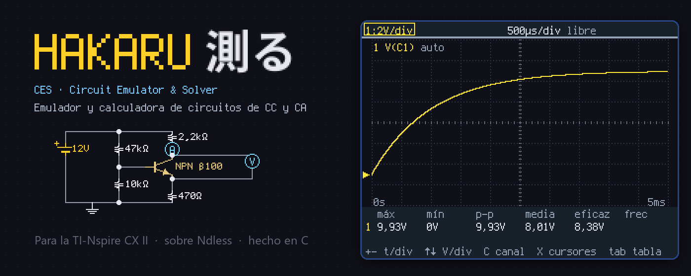
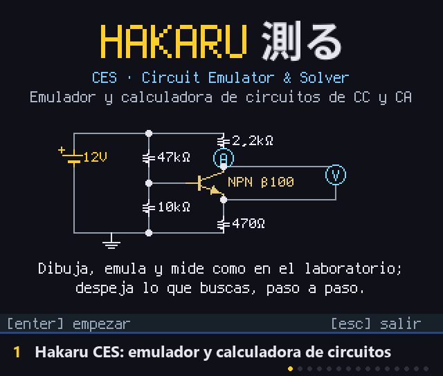
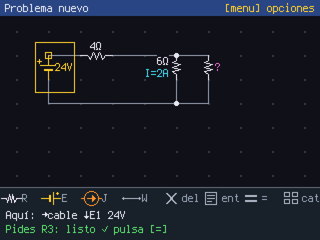
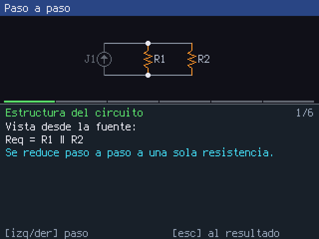
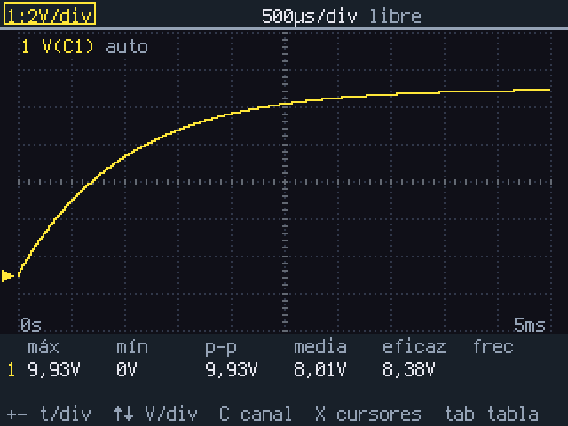
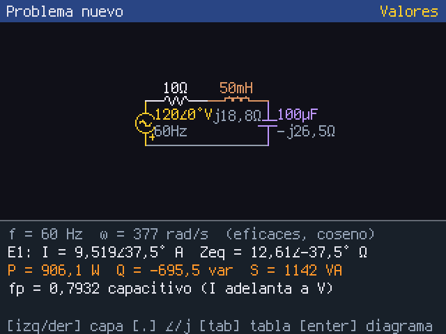
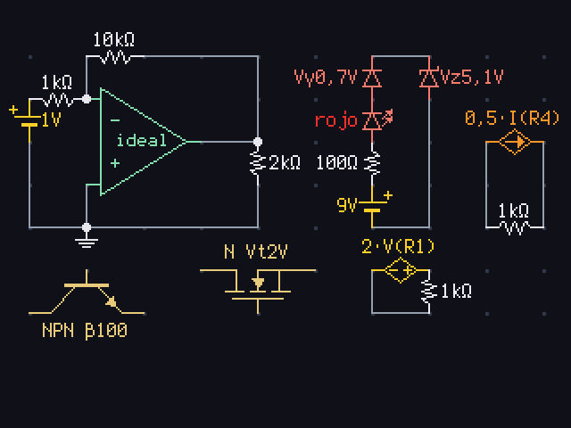
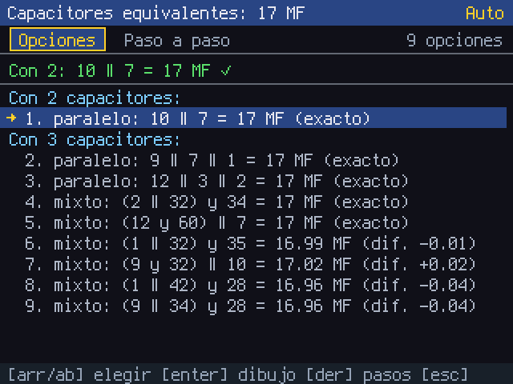
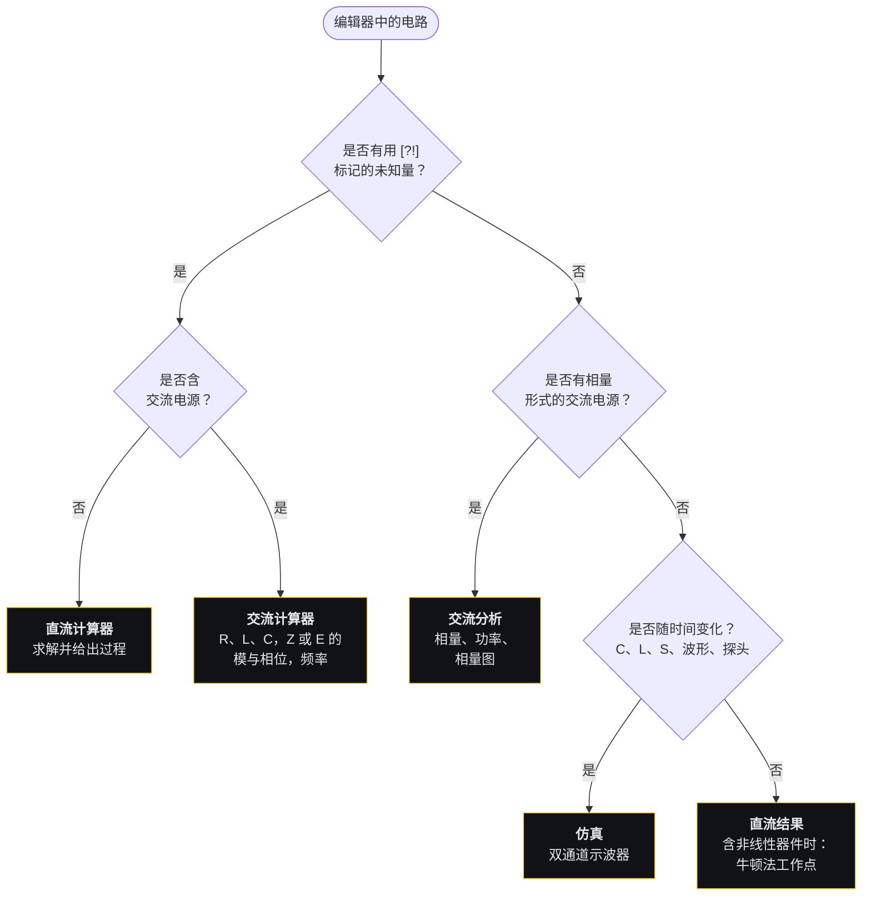
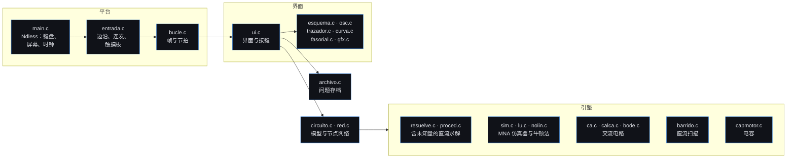

<p align="center">
  
</p>

<p align="center">
  
  
  
  
  <a href="LICENSE"></a>
</p>

<p align="center">
  <a href="README.md"></a>
  <a href="README.en.md"></a>
  <a href="README.zh-CN.md"></a>
  <a href="https://github.com/Eliam4510/hakaru-ces/releases/latest"></a>
  
  
  
</p>

<p align="center">
  <b>适用于 TI-Nspire CX II 的直流与交流电路仿真器和计算器。</b>
</p>

<p align="center">
  <a href="#安装">安装</a> ·
  <a href="docs/MANUAL.md">使用手册</a> ·
  <a href="docs/COMPILAR.md">编译</a> ·
  <a href="docs/DESIGN.md">设计</a> ·
  <a href="docs/HOJA_DE_RUTA.md">路线图</a>
</p>

<p align="center">
  
</p>

## 简介

Hakaru CES 是一款运行于 [Ndless](https://ndless.me/) 之上的原生程序，适用于
TI-Nspire CX II 和 CX II CAS 图形计算器。其名称由 *hakaru*（測る，日语意为
“测量”）与缩写 CES（*Circuit Emulator & Solver*，电路仿真与求解器）组成。
程序在计算器上集成了电路编辑器和多个分析引擎，思路与 NI Multisim 相似，
并针对 320 × 240 像素的屏幕进行了适配：

- 求解含未知量的直流电路，并给出逐步求解过程；
- 采用改进节点分析法（MNA）进行时域仿真，配备双通道示波器；
- 正弦稳态分析：相量、功率、相量图、戴维南与诺顿等效电路、波特图绘制器以及
  交流计算器；
- 使用牛顿法计算含二极管、运算放大器和晶体管电路的工作点，并支持直流扫描。

程序界面及详细文档均为西班牙语。

## 功能

<table>
  <tr>
    <td width="33%" align="center"></td>
    <td width="33%" align="center"></td>
    <td width="33%" align="center"></td>
  </tr>
  <tr>
    <td valign="top"><b>电路编辑器</b><br>基于网格的编辑方式：按元件对应的按键再按方向键即可放置元件。提供元件面板、撤销与重做、复制与粘贴、输入框内的算术表达式以及问题存档功能。</td>
    <td valign="top"><b>带过程的求解</b><br>用 <code>[?!]</code> 标记的量（电阻、电源、电池内阻等）将按完整过程求解：串并联化简、欧姆定律或基尔霍夫定律，结果以精确分数给出。</td>
    <td valign="top"><b>时域仿真</b><br>支持电容、电感、定时开关以及带波形的电源。双通道示波器具备光标、触发和测量功能，并提供能量表与自然响应分析。</td>
  </tr>
  <tr>
    <td width="33%" align="center"></td>
    <td width="33%" align="center"></td>
    <td width="33%" align="center"></td>
  </tr>
  <tr>
    <td valign="top"><b>交流电路</b><br>电压与电流相量、有功与无功功率（含 Boucherot 与 Tellegen 功率平衡）、相量图、波特图绘制器，以及可求解 R、L、C、相位或频率的交流计算器。</td>
    <td valign="top"><b>半导体与放大器</b><br>二极管、稳压二极管、发光二极管、受控源、运算放大器、BJT 和 MOSFET：牛顿法工作点、直流扫描、小信号分析以及各器件的特性曲线。</td>
    <td valign="top"><b>等效电容</b><br>确定如何用库存中的电容替换某一电容（例如单相电动机的启动电容）：使用一个、两个或三个电容，以串联、并联或混联方式组合，并给出计算过程和接线图。</td>
  </tr>
</table>

**Aprende**（学习）模块包含 13 节带理论讲解的课程、40 个已解例题和 42 个可直接
仿真的模型电路，另有隐藏答案的练习模式。

<details>
<summary><b>可用元件</b></summary>

| 类别 | 元件 |
|---|---|
| 电源 | 电压源（理想或含内阻的实际电源）和电流源；直流、交流（相量）或带波形：正弦波、方波、三角波和脉冲 |
| 无源元件 | 电阻、电容、电感、阻抗 Z、定时开关 |
| 仪表 | 电压表和电流表（理想或含内阻）、功率表、示波器探头 |
| 二极管 | 理想模型、含 Vγ 模型、指数模型、1N4148、1N4007、稳压二极管、六种颜色的发光二极管 |
| 有源元件 | 受控源（四种）、运算放大器（理想或实际，含饱和）、含厄尔利效应的 NPN/PNP 型 BJT、N/P 沟道 MOSFET |

</details>

## 分析方式的选择

按下 `[=]` 键后，程序根据电路内容自动确定分析类型：



其他按键用于打开补充分析：`[B]` 波特图，`[I]` 直流扫描，`[P]` 工作点，
`[T]` 戴维南与诺顿等效电路。

## 验证

| 352 164 | 42 | 40 | 13 | 3 |
|:-:|:-:|:-:|:-:|:-:|
| 项测试框架检查，零失败 | 个模型电路 | 个带答案的已解例题 | 节课程 | 个独立参照程序 |

整个程序同样可以在 PC 上编译，由测试框架通过按键脚本驱动运行：检验各计算引擎，
将每个界面导出为图像，并对界面进行数百万次随机按键测试。仿真器、交流分析和工作点
计算还与使用 Python（numpy、SciPy、mpmath）独立编写的参照仿真器进行了比对：
随机电路网络的一致率分别为 98/98、174/174 和 260/260。

## 安装

1. 计算器（TI-Nspire CX II 或 CX II CAS）须已安装并激活
   [Ndless](https://ndless.me/)。
2. 从[最新版本](https://github.com/Eliam4510/hakaru-ces/releases/latest)下载
   `hakaru_ces.tns`，并使用 TI Connect CE 或 TI-Nspire Link 将其复制到计算器的
   任意文件夹中。
3. 在计算器上打开该文件，选择 «Taller»（工作台）> «Problema nuevo»（新问题）。

程序将其文件保存在 `.tns` 所在的同一文件夹中：`ces_01.tns` 至 `ces_20.tns`
（已保存的问题）、`ces_sesion.tns`（退出时编辑器中的电路）以及
`ces_controles.tns`（键盘与触摸板设置）。

## 基本用法

1. 在 **Taller > Problema nuevo** 中，使用方向键移动光标。
2. 每个元件通过**其对应按键加一个方向键**放置：`[E]` `[→]` 放置一个朝右的
   电源，`[R]` `[↓]` 放置一个朝下的电阻，`[W]` 绘制导线直至按下 `[esc]`。
   `[catalog]` 键打开完整的元件面板。
3. 在每个元件的**参数表**中，数字表示**已知数据**，`[?!]` 标记**未知量**，
   `[del]` 表示该值未知。单位前缀写在数字之后（`4.7` `[K]` = 4.7 kΩ），
   并支持 `1÷(1÷4k+1÷6k)` 这类表达式。
4. `[=]` 进行求解、仿真或分析。在结果界面中，`[左/右]` 切换电路图的显示层，
   `[tab]` 打开数据表，`[enter]` 显示求解过程。
5. `[ctrl]` `[S]` 保存当前问题。

按键与界面的完整说明见[使用手册](docs/MANUAL.md)（西班牙语）。

## 编译与测试

需要在 Linux 或 WSL 中安装 [Ndless SDK](https://github.com/ndless-nspire/Ndless)：

```bash
make                    # 生成 hakaru_ces.tns（SDK 须在 PATH 中）
sh build_tns.sh         # 同上，SDK 位于 /opt/Ndless
sh build_host.sh        # 在 PC 上运行测试框架；每个界面的截图保存在 out/ 中
```

环境配置、分部测试、随机按键测试、输入层回归测试以及参照程序的说明见
[docs/COMPILAR.md](docs/COMPILAR.md)（西班牙语）。

## 架构



<details>
<summary><b>各文件内容</b></summary>

| 文件 | 内容 |
|---|---|
| `main.c`、`bucle.c`、`entrada.c` | 启动、帧循环与输入层（按键、连发、触摸板、电源管理） |
| `ui.c`、`esquema.c`、`gfx.c`、`font*.c`、`kanji_img.c` | 界面：各屏幕、电路绘制、图形与字体 |
| `circuito.c`、`red.c`、`tipos.c` | 电路模型及其节点网络提取 |
| `resuelve.c`、`algebra.c`、`arbol.c`、`proced.c`、`pasos.c`、`numfmt.c` | 含未知量的直流引擎与逐步求解过程 |
| `sim.c`、`lu.c`、`ondas.c`、`nolin.c`、`osc.c` | 时域仿真器（MNA）、波形、牛顿法与示波器 |
| `ca.c`、`cx.c`、`luc.c`、`calca.c`、`bode.c`、`trazador.c`、`fasorial.c` | 交流电路：相量、交流计算器、波特图与相量图 |
| `barrido.c`、`curva.c` | 直流扫描及其曲线 |
| `biblioteca.c`、`ejemplos.c`、`lecciones.c` | 42 个模型电路、40 个例题与 13 节课程 |
| `capmotor.c`、`capmotor_dib.c`、`capeq_texto.c` | 等效电容：计算、接线图、理论与例题 |
| `archivo.c` | 问题存档、会话与设置（`CESP` 格式） |
| `banco.c`、`turbo.c`、`cf_arm.c` | 计时基准测试、实验性超频（已禁用）与 ARM 快速浮点运算 |
| `host_test.c`、`test_*.inc` | PC 端测试框架 |
| `herramientas/` | Python 参照程序与生成工具（字体、汉字图像、数据表及本文档中的图片） |
| `docs/` | 使用手册、编译、设计、路线图与版本历史 |

</details>

## 文档

详细文档以西班牙语撰写。

| 文档 | 内容 |
|---|---|
| [使用手册](docs/MANUAL.md) | 按界面逐一说明程序的使用方法及全部按键 |
| [编译与测试](docs/COMPILAR.md) | 环境、编译、测试框架、随机按键测试与参照程序 |
| [设计](docs/DESIGN.md) | 架构、引擎、设计决策及各阶段的验证 |
| [路线图](docs/HOJA_DE_RUTA.md) | 当前状态、待完成工作及待在计算器上进行的测试 |
| [版本历史](docs/HISTORIAL.md) | 从 ElectroFock 到 Hakaru CES 4.0 的各个版本 |

## 许可与致谢

Hakaru CES 由 **Eliam Mojardin Ibarra** 开发，以 [MIT](LICENSE) 许可证发布。

程序文本使用 Terminus 字体（© Dimitar Toshkov Zhekov），标题界面的汉字使用
Noto Sans JP 字体（© Adobe），两者均采用 SIL Open Font License 1.1 许可。
程序使用 Ndless SDK 编译。TI-Nspire 是德州仪器（Texas Instruments）的商标；
本项目与该公司无关联。详见 [AVISOS.md](AVISOS.md)。
