# Manual de Hakaru CES

Hakaru CES 4.0 · TI-Nspire CX II / CX II CAS con Ndless.

Las teclas se escriben entre corchetes: `[enter]`, `[esc]`, `[tab]`,
`[menu]`, `[del]`, `[=]`, `[?!]` (la tecla de la interrogación y la
exclamación), `[catálogo]` (la del libro), `[izq]` `[der]` `[arr]` `[ab]`
(las flechas). «Tecla + flecha» quiere decir pulsar la tecla y después una
flecha.

**Contenido**

1. [El menú principal](#1-el-menú-principal)
2. [El Taller: dibujar](#2-el-taller-dibujar)
3. [La ficha de un componente](#3-la-ficha-de-un-componente)
4. [Calcular en continua](#4-calcular-en-continua)
5. [Emular en el tiempo](#5-emular-en-el-tiempo)
6. [Corriente alterna](#6-corriente-alterna)
7. [Semiconductores y amplificadores](#7-semiconductores-y-amplificadores)
8. [Capacitores equivalentes](#8-capacitores-equivalentes)
9. [Aprende y el modo práctica](#9-aprende-y-el-modo-práctica)
10. [Guardar: Mis problemas y la sesión](#10-guardar-mis-problemas-y-la-sesión)
11. [Teclas, repetición y touchpad](#11-teclas-repetición-y-touchpad)
12. [El banco de tiempos](#12-el-banco-de-tiempos)

---

## 1. El menú principal

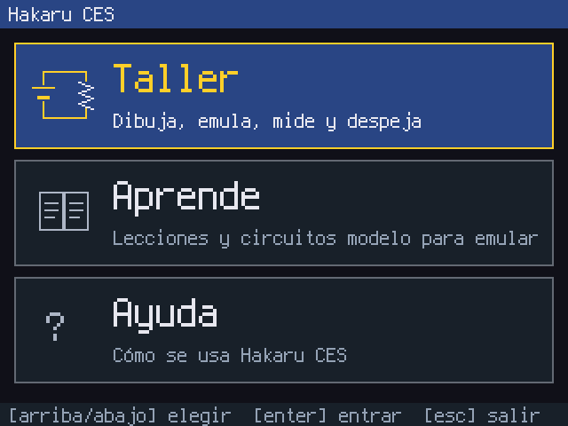

| Parte | Qué hace |
|---|---|
| **Taller** | Editor de circuitos: el programa calcula, emula o analiza el circuito dibujado. Tiene cuatro opciones: «Problema nuevo», «Seguir con el problema actual», «Mis problemas guardados» y **«Capacitores equivalentes»**. |
| **Aprende** | 13 lecciones. Las 9 primeras, de corriente continua, con teoría y 40 ejemplos resueltos (ley de Ohm, serie, paralelo, mixtos, despejar, potencia, Kirchhoff, fuentes reales, fuentes de corriente e instrumentos, y nueve problemas de pizarrón). Las otras 4 traen 42 circuitos modelo para emular: **Circuitos en el tiempo** (12), **Corriente alterna** (10: filtros, resonancia, fasores, vatímetro, corrección del factor de potencia, Thévenin), **Diodos** (10) y **AO y transistores** (10). |
| **Ayuda** | Este manual, resumido, en la calculadora. |

`[arr/ab]` elige, `[enter]` entra y `[esc]` vuelve.

## 2. El Taller: dibujar

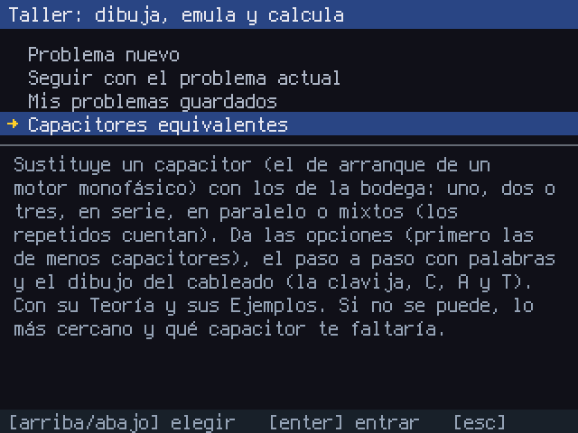

El editor es una rejilla con un cursor (el cuadrito amarillo). Una flecha sola
mueve el cursor; **tecla + flecha** pone un componente desde el cursor hacia
esa flecha. La tecla de cada componente es la letra de su etiqueta, y la
barra de herramientas de abajo la recuerda.

| Tecla | Acción |
|---|---|
| `[R]` + flecha | resistencia |
| `[E]` + flecha | fuente de tensión (el + queda hacia la flecha) |
| `[J]` + flecha | fuente de corriente (la flecha es su sentido) |
| `[V]` / `[A]` + flecha | voltímetro / amperímetro |
| `[C]` / `[L]` / `[S]` + flecha | condensador / bobina / interruptor |
| `[D]` / `[U]` / `[Q]` / `[M]` + flecha | diodo / amplificador operacional / BJT / MOSFET (zener, LED y fuentes controladas, en la paleta) |
| `[Z]` + flecha | impedancia (el vatímetro, en la paleta) |
| `[O]` | sonda del osciloscopio |
| `[W]` + flechas | cable, tramo a tramo, hasta `[esc]` |
| `[del]` + flechas | borrar, hasta `[esc]` |
| `[G]` | tierra (0 V) en el cursor, en un punto del circuito; otra vez, la quita |
| `[T]` | terminal A en el cursor; en otro punto, el B (el resultado da V(AB), y sus nodos se llaman A y B en los potenciales, los pasos, la tabla de CA y el osciloscopio) |
| `[catálogo]` | la paleta con todos los componentes y su tecla |
| `[enter]` | editar el elemento junto al cursor (si hay varios, + flecha) |
| `[tab]` | elegir el siguiente elemento (`[shift]` `[tab]`, el anterior); `[enter]` justo después abre su ficha sin preguntar la flecha |
| `[=]` | resolver, emular o analizar; `[?!]`: practicar con la solución tapada |
| `[I]` / `[P]` | barrido de CC / punto de operación de CC |
| `[B]` | Bode del circuito |
| `[F]` | girar la fuente elegida (en un AO, un BJT o un MOSFET, el espejo) |
| `[ctrl]` `[Z]` / `[ctrl]` `[Y]` | deshacer / rehacer |
| `[ctrl]` `[S]` | guardar en Mis problemas |
| `[ctrl]` `[N]` | ponerle nombre (letras, cifras y espacio; `[shift]`, mayúscula) y guardarlo |
| `[ctrl]` `[C]` / `[ctrl]` `[X]` | copiar / cortar el elemento elegido (o el único junto al cursor), con sus valores |
| `[ctrl]` `[V]` + flecha | pegar la copia (otra etiqueta, los mismos valores); se abre su ficha |
| `[menu]` | opciones: resolver, practicar, deshacer, guardar (o una copia en otro hueco), borrar todo, ayuda, tiempo y paso (o frecuencia y convenio en CA), Bode, barrido |

`[shift]` y `[ctrl]` se pueden pulsar a la vez que la otra tecla o antes:
quedan armados para la siguiente (se ve «shift» o «ctrl» en la barra).

**Deshacer** tiene 12 niveles; mirar una ficha sin cambiar nada no gasta
ninguno. «Problema nuevo», abrir otro de Mis problemas o traer un ejemplo o
un modelo al Taller con `[tab]` tampoco pierden el circuito de antes:
`[ctrl]` `[Z]` lo recupera, con su hueco. El enunciado del ejemplo o modelo
traído se ve entero en las dos líneas de abajo.

Al volver con `[esc]` de un error (un `[=]` que no puede calcular, emular o
analizar), el cursor queda en el elemento culpable y `[enter]` abre su ficha
en la fila que falla. La línea inferior indica, durante la edición, qué se pide y si
los datos alcanzan (la regla de la continua: **tantos datos de V o I como
valores desconocidos**, entre R, E, J y r).

## 3. La ficha de un componente

Al poner un elemento se abre su ficha. En cada campo:

- un **número** es un **dato**;
- `[?!]` marca una **incógnita**;
- `[del]` es **no se sabe** (el campo queda vacío).

En la fuente de tensión: E, la I que entrega, su **r interna** (vacía =
ideal) y la V en sus bornes. En un voltímetro o un amperímetro: lo que marca y
su R interna (vacía = ideal).

**Prefijos**, detrás del número: `[P]` pico, `[N]` nano, `[U]` micro, `[M]`
mili, `[K]` kilo, `[shift]` `[M]` mega, `[G]` giga (`4.7` `[K]` = 4,7 kΩ);
`[EE]` para el exponente. Debajo del campo se ve cuánto vale lo escrito
(`= 0,047 Ω`).

**Cuentas**: `+` `−` `×` `÷` `^`, paréntesis y `x²`, con los prefijos pegados a
cada número: `220^2÷100` da 484 y `1÷(1÷4k+1÷6k)` da 2,4 k. El eco enseña el
resultado, y eso es lo que se guarda. Si la cuenta no vale (un paréntesis sin
cerrar, una división entre cero, un negativo donde no va signo) la ficha lo
dice y lo escrito se queda para corregirlo; un segundo `[esc]` lo tira. En una
Z de alterna, `+` y `−` siguen siendo +j y −j: ahí no hay cuentas.

Un campo con algo que no es un número, un valor fuera de rango o una R de
menos de 1 µΩ no se acepta: la ficha dice por qué y se queda en ese campo.

**Teclas de la ficha.** En un circuito de continua, `[tab]` confirma el campo
y pasa a la ficha del siguiente elemento (en alterna, `[tab]` es la caja del
ángulo). `[menu]` confirma y abre las opciones del editor; `[ctrl]` `[Z]`
deshace (si se colocó una pieza encima de otra, vuelve la anterior: la ficha
avisa «Sustituye a R1 …»), `[ctrl]` `[Y]` rehace y `[ctrl]` `[S]` confirma y
guarda; `[ctrl]` con `[C]`, `[X]`, `[V]` o `[N]` confirma y vuelve al editor
para copiar, cortar, pegar o poner nombre. `[catálogo]` en la ficha de un
semiconductor enseña las ecuaciones de su modelo, y ahí `[I]` dibuja su curva.

## 4. Calcular en continua

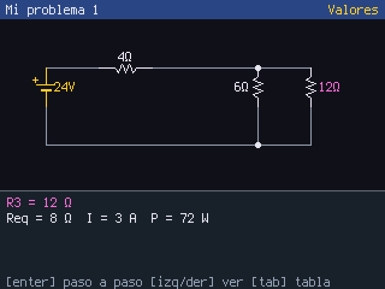

Con algún `[?!]` en el circuito, `[=]` lo **calcula**. Resuelve cualquier red
de fuentes de tensión (ideales o reales), fuentes de corriente, resistencias e
instrumentos.

- Si el circuito es de **una fuente** (de tensión, real o de corriente) y lo
  demás es serie-paralelo, el procedimiento es el de la pizarra: estructura,
  reducción, ley de Ohm (`I = E/Req`, o `V = J·Req` con una J; con una fuente
  real, la r entra en serie), despejes y reparto. Si el dato está en una
  resistencia y la incógnita en otra, avanza paso a paso.
- Si no se puede reducir (un puente, varias fuentes, instrumentos), el
  procedimiento son las **leyes de Kirchhoff** con los números, con las letras
  de los nodos en el dibujo.
- Una pila (fuente con r) en corto da su corriente de cortocircuito, E/r.
- Avisa de lo que no tiene sentido: una J sin camino de vuelta, un
  amperímetro o un cable que ponen una fuente ideal en corto, una r que
  tendría que ser negativa o que no se puede hallar porque no pasa corriente,
  una R que tendría que valer 0, E y r de la misma fuente pedidas a la vez.

**En el resultado**: `[izq/der]` cambia lo que se ve en el dibujo (valores,
corrientes con su sentido, tensiones, potencias, potenciales de nodo con su
letra, nombres); `[tab]` abre la tabla completa («P abs» es la que absorbe
cada uno, negativa si entrega; abajo, el balance: entregan = absorben);
`[enter]`, el **procedimiento paso a paso**, con el dibujo resaltando lo que
usa cada paso.

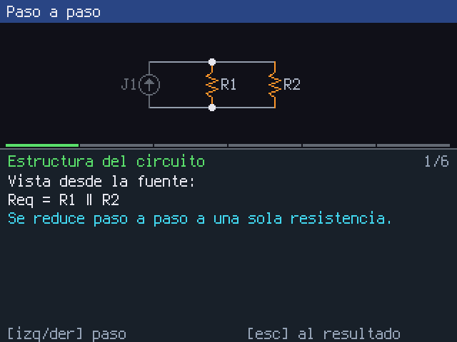

Si se piden hasta tres cosas, cada una sale también como fracción cuando la
hay (`R1 = 440/7 ≈ 62,857 Ω`); sin nada pedido, el panel da el balance. Con
terminales A y B, sale V(AB). En la tabla, los números muy grandes o muy
pequeños llevan prefijo (`918 µW`, `3,588 MW`, `13,251 mW`). Un vatímetro
dice «marca −9 W», con 0 W en «P abs» (no absorbe).

`[T]` en el resultado da **Thévenin y Norton** entre A y B, con la carga de
máxima potencia (también en alterna).

## 5. Emular en el tiempo

`[=]` **sin ningún `[?!]`** en un circuito con C, L, S, una fuente que no es
continua, una sonda o un multímetro en CA lo **emula**: lo deja correr desde
t = 0, como en el laboratorio (las fuentes se encienden en 0), y abre el
osciloscopio. La ventana y el paso salen solos de las constantes de tiempo y
de los periodos; `[menu]` > Emulación: tiempo y paso, para fijarlos. Mientras
emula, una barra dice cuánto falta y `[esc]` lo corta.

| Componente | Ficha |
|---|---|
| `[C]` condensador | C y V0 (su tensión al empezar, con el + en el borne donde empezaste; vacía = la de CC) |
| `[L]` bobina | L e I0 (su corriente al empezar; vacía = la de CC) |
| `[S]` interruptor | `[izq/der]`: abierto o cerrado al empezar; t1 (cuándo cambia) y t2 (cuándo vuelve) |
| `[E]`, `[J]` | `[izq/der]`: continua, senoidal (pico, CC, f, fase), cuadrada o triangular (V1, V2, f, ciclo) o pulso (V1, V2, t0, ancho) |
| `[V]`, `[A]` | `[izq/der]`: marcan en CC (media), CA (eficaz de la alterna) o CA+CC |
| `[O]` sonda | `[enter]`: la tensión de ese punto; una flecha: la I del elemento, luego su V |

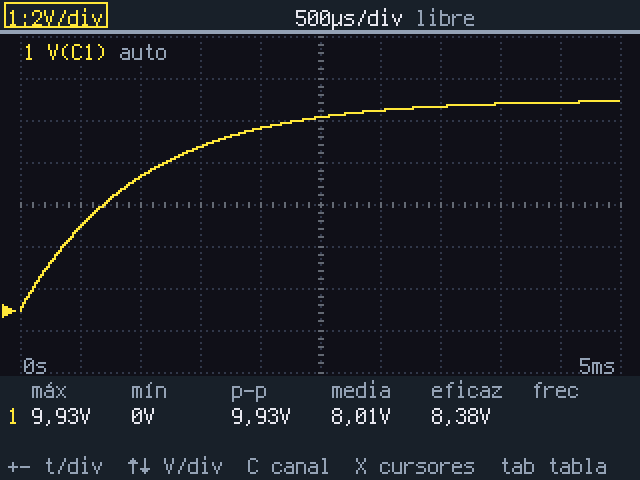

**El osciloscopio** tiene dos canales:

| Tecla | Acción |
|---|---|
| `[+]` `[-]` | tiempo por división |
| `[arr]` `[ab]` | voltios por división del canal activo |
| `[C]` | cambia de canal |
| `[X]` | cursores T1 y T2 (admite un tiempo escrito: `1` `[M]` es 1 ms) |
| `[M]` | medidas o cursores (con cursores, las medidas son entre T1 y T2) |
| `[U]` | el último periodo (T1 y T2 en sus bordes: el régimen permanente, con su frecuencia) |
| `[P]` | el siguiente pico |
| `[D]` | disparo: subida, bajada o libre, al nivel medio de lo que se ve |
| `[A]` | autoescala |
| `[=]` | emula hasta donde miras (o más fino entre T1 y T2) |
| `[tab]` | la **tabla** y el **esquema** |

Debajo van las medidas de cada canal: máximo, mínimo, pico a pico, media,
eficaz y frecuencia. La tabla da los valores al final, los máximos, los
eficaces con la P media, las energías con su balance y la respuesta natural
(s, τ, fd y ζ); el esquema, el circuito con los valores al final.

Si algo no tiene sentido (dos fuentes ideales en paralelo, un interruptor que
al cerrarse pone una fuente en corto, una J sin camino), lo dice antes de
emular, con el lazo resaltado y su instante.

## 6. Corriente alterna

En la ficha de una E o una J, `[izq]` elige la forma **alterna (fasor)**:
módulo, `[tab]` y el ángulo en grados (`120` `[tab]` `30` es 120∠30°). Son
valores **eficaces con coseno**, e(t) = √2·E·cos(ωt + θ), a la frecuencia de
todo el circuito (su fila en la ficha; 60 Hz al empezar). `[menu]` > Ajustes
de CA cambia la f y el convenio con que se ve (pico o eficaz, coseno o seno).

| Componente | Ficha |
|---|---|
| `[Z]` impedancia | R + jX (`30` `[+]` `40`, `[J]` `40`) o \|Z\| `[tab]` ángulo; en el Bode se porta como R con L (X > 0) o con C (X < 0) |
| vatímetro (en la paleta) | la flecha hacia la carga; la bobina de tensión va a la tierra. Marca P y el fp (+ inductivo, − capacitivo) |
| `[V]`, `[A]` | en un circuito de alterna marcan el eficaz |

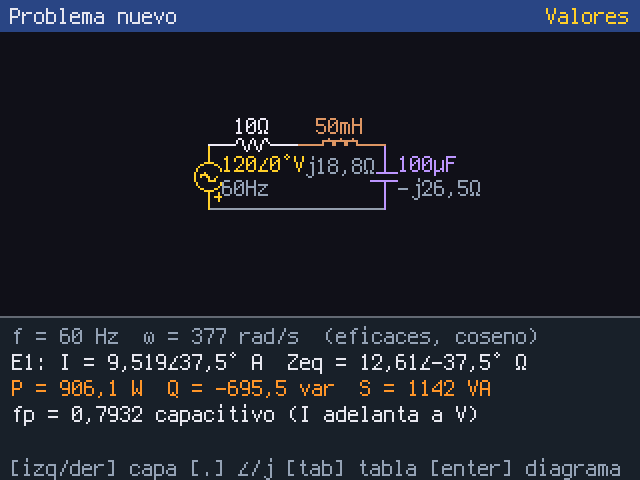

`[=]` da los **fasores**: el esquema con V, I, P y Q de cada elemento (6
capas con `[izq/der]`; los potenciales, con la letra del nodo); `[.]` cambia
entre polar y rectangular; `[tab]` abre la tabla (fasores, potencias, los
balances de Boucherot y Tellegen, potenciales y, en la quinta página, **en el
tiempo**: v(t) e i(t) de pico de cada elemento); `[enter]` el **diagrama
fasorial** (`[R]` elige la referencia, `[S]` suma: Kirchhoff a la vista) y,
con `[der]`, el **triángulo de potencias**. `[T]` da Thévenin y Norton; `[O]`
emula el circuito en el tiempo, para ver cómo se llega al fasor.

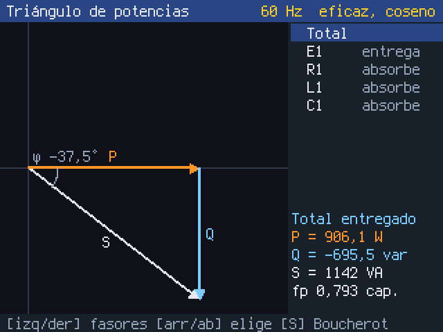

**La calculadora de CA** despeja hasta 4 valores (R, L, C, \|Z\| o su ángulo,
\|E\| o su ángulo, la f) con datos en fasor o solo en módulo. Por ejemplo, «el
voltímetro sobre R marca 72 V: ¿L?» da L1 = 106,1 mH; la P y el fp de un
vatímetro con `[?!]` en una C corrigen el factor de potencia de un motor.
Enseña todas las soluciones (`[arr/ab]`) y, si no hay, dice por qué: faltan
datos, el dato no se alcanza (y qué rango sí), dos incógnitas que no se
separan…

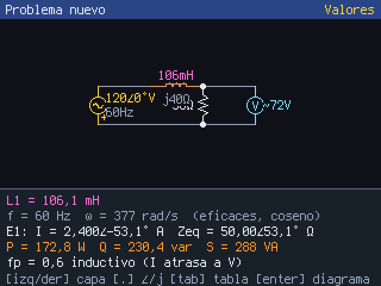

**El trazador de Bode** (`[B]`, o `[menu]` > Bode) barre la frecuencia con
autorrango: |H| en dB y la fase, con cursores exactos (admite una f escrita: `1`
`[K]` `[enter]`), las marcas (−3 dB, f0, pico, valle) y el tipo de filtro con
su fc, f0, BW y Q. `[tab]` abre los fasores a la f del cursor. Mientras el
cursor corre, la lectura sale de la malla con «≈»; al soltar, la exacta.

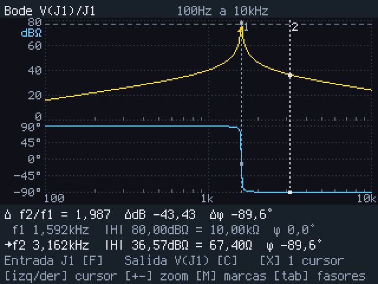

## 7. Semiconductores y amplificadores

| Tecla | Componente | Ficha |
|---|---|---|
| `[D]` + flecha | diodo, del ánodo (donde empiezas) al cátodo (la raya) | `[izq/der]` el modelo: ideal (un interruptor), con Vγ (Vγ y rd), exponencial (Is, n, Rs), 1N4148 o 1N4007 |
| paleta | zener | Vz a Iz y rz (de libro, exponencial o 1N4733A) |
| paleta | LED | su color (rojo, naranja, amarillo, verde, azul, blanco), Vf a If e Im |
| paleta | E y J controladas (el rombo) | fila x: `[+]` `[-]` elige quién la manda; `[izq/der]` el tipo: e = μ·V(x), e = r·I(x), j = g·V(x) o j = β·I(x) |
| `[U]` + flecha | amplificador operacional, con la flecha hacia la salida (`[F]` cambia + y −) | ideal o real (A, Ri y Ro); satura en V+ y V− (±15 V si no se dice). Su salida se mide desde la tierra: pon `[G]` |
| `[Q]` + flecha | BJT, de la base hacia C y E (`[F]` los cambia) | NPN o PNP; β, Is, VA (Early; vacía, sin él) y βr |
| `[M]` + flecha | MOSFET, de la puerta G hacia D y S | canal N o P; Vt, K y VA (es simétrico: con VDS < 0, D y S cambian) |

- **`[=]` sin `[?!]`** da el **punto de operación** de CC (Newton), con cada
  no lineal en su región (conduce, corte, ruptura; lineal o satura; activa,
  corte, saturación, inversa u óhmica) y el residuo de Kirchhoff. Si el
  circuito cambia con el tiempo, lo emula (un rectificador, un astable). El
  LED se enciende con su corriente media; con más de Im, «se quemaría».
- Un `[?!]` en un valor no se despeja con no lineales: **`[I]`** barre y `[N]`
  lee. **`[P]`** da el punto de operación de CC de cualquier circuito (C
  abiertos, L cables). `[B]`: el Bode de pequeña señal en ese punto.
- `[catálogo]` en la ficha enseña las ecuaciones del modelo; `[I]` ahí, su
  curva I-V (diodo, zener, LED) o su familia de 6 curvas (IC(VCE) con IB en
  pasos, o ID(VDS) con VGS en pasos).

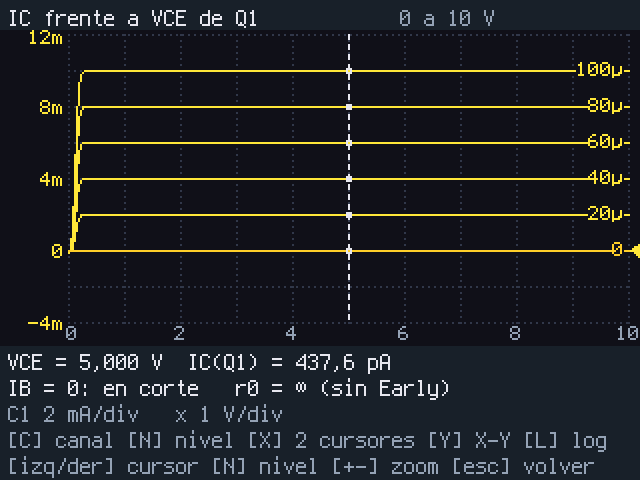

**El barrido de CC** (`[I]`, o `[menu]` > Barrido) cambia una E, una J, una R
o una ganancia y dibuja sus canales (las sondas, o la I y la V del primer
diodo, o la salida del AO):

| Tecla | Acción |
|---|---|
| `[izq/der]` | el cursor |
| `[N]`, un nivel y `[enter]` | el x donde se cruza (con un dato, el cursor ya está ahí: «¿qué R da 20 mA?») |
| `[X]` | dos cursores |
| `[Y]` | la gráfica X-Y |
| `[L]` | escala logarítmica |
| `[+]` `[-]` | acerca o aleja |
| `[=]` | barre lo que se ve |
| `[tab]` | el circuito en el cursor |
| `[menu]` | qué se barre, el rango y la ida y vuelta (la histéresis de un Schmitt) |

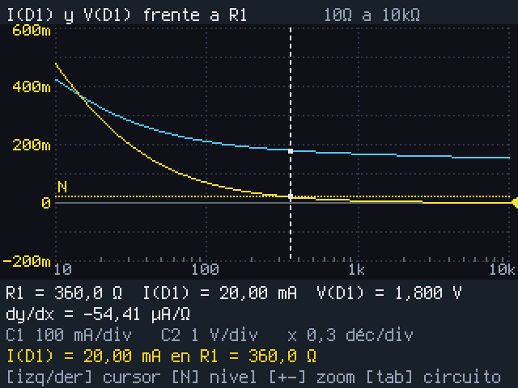

## 8. Capacitores equivalentes

La cuarta opción del Taller. Sirve para **sustituir un capacitor** (el caso
típico: el capacitor de arranque de un motor monofásico se quemó y en la
bodega no hay uno igual) con los capacitores que sí hay: uno solo, dos o tres,
en serie, en paralelo o mixtos. Tiene su propio menú: **Resolver**,
**Teoría** y **Ejemplos**.

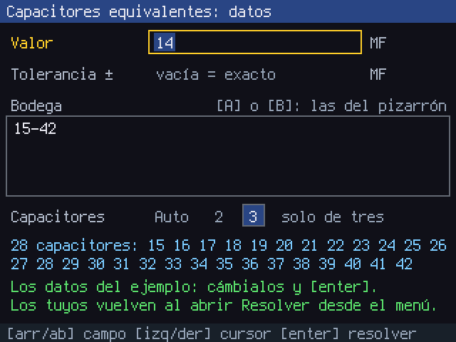

**Resolver** pide:

- **Valor**: el capacitor que hay que sustituir, en MF (microfaradios, µF,
  como se escribe en las placas de los motores).
- **Tolerancia**: cuánto se puede alejar el resultado. Vacía: exacto, con el
  margen del redondeo a un decimal (±0,05 MF).
- **Bodega**: los capacitores disponibles, separados con `[espacio]`. Los
  **repetidos cuentan**: `7 7` son dos de 7 MF (y entonces 7 ∥ 7 vale; con un
  solo 7, no). `15-42` es un rango (15, 16, …, 42) y `sin 21-24` quita
  valores; `[A]` y `[B]` cargan dos bodegas de ejemplo.
- **Capacitores**: Auto (busca con 1, 2 y 3) o solo 2 o solo 3 (si se pide
  un número fijo).

En los campos, `[izq/der]` mueven el cursor, `[shift]` salta de valor y
`[ctrl]` va a un extremo. `[enter]` resuelve.

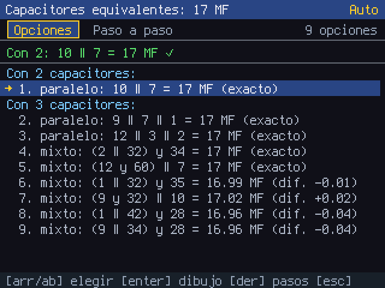

El resultado tiene dos pestañas (`[izq/der]` o `[tab]`):

- **Opciones**: todas las combinaciones que valen, primero las de **menos
  capacitores** y, dentro de cada número, de la **más cercana** al valor a la
  más lejana. `[arr/ab]` elige y `[enter]` dibuja el cableado de esa opción
  (la clavija y los bornes C, A y T).
- **Paso a paso**: el procedimiento explicado con palabras: por qué serie o
  paralelo, las cuentas y la comprobación.

Las fórmulas que usa:

| Arreglo | Capacidad total |
|---|---|
| uno | CT = c |
| paralelo | CT = a + b |
| serie | CT = a·b/(a + b) |
| paralelo de 3 | CT = a + b + c |
| serie de 3 | 1/CT = 1/a + 1/b + 1/c |
| mixto 1: (a ∥ b) en serie con c | CT = (a + b)·c/(a + b + c) |
| mixto 2: (a en serie con b) ∥ c | CT = a·b/(a + b) + c |

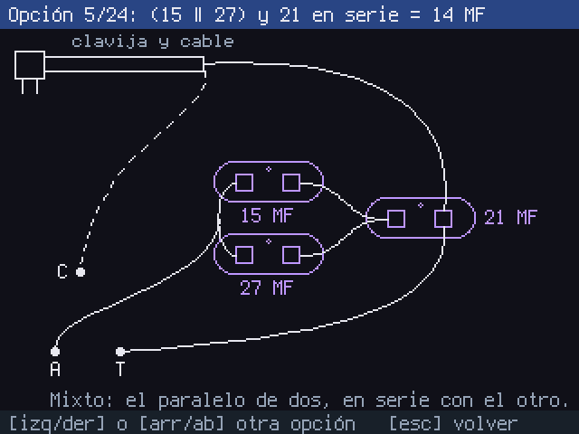

Si no hay ninguna combinación que valga, lo dice, da **la más cercana** y
**qué capacitor faltaría** para lograrlo. Por ejemplo, 17 MF con la bodega
A da 10 ∥ 7 = 17 MF ✓.

## 9. Aprende y el modo práctica

Cada lección tiene páginas de **teoría** (`[izq/der]` pasa de página y
`[enter]` va a los ejemplos) y una lista de **ejemplos** o **modelos**. Un
ejemplo se abre con su resultado y su procedimiento; `[tab]` lo trae al
Taller para modificarlo. En un modelo (lecciones 10 a 13), la lista enseña
su enunciado, qué mirar y una miniatura del circuito; `[enter]` lo emula (o
lo analiza, lo calcula o lo barre, según el modelo) y `[tab]` lo lleva al
Taller.

**Practicar.** Para estudiar, no solo para comprobar. En el editor, `[?!]` (o
`[menu]` > Practicar) resuelve con las respuestas **ocultas**: se escribe el
valor, `[enter]`, y el programa indica si es correcto (al 1 %) o cuál era el valor esperado.
`[enter]` sin número abre el paso a paso, donde cada paso se destapa con
`[enter]`; `[tab]` lo destapa todo. En Aprende, `[?!]` en la lista de
ejemplos tapa las explicaciones y cada ejemplo se abre para practicar. Si los
datos admiten varias soluciones, vale cualquiera, pero todas las respuestas
tienen que salir de la misma.

## 10. Guardar: Mis problemas y la sesión

- `[ctrl]` `[S]` guarda en **Mis problemas** (20 huecos). Un circuito nuevo
  se llama «Mi problema N» (el aviso recuerda que `[ctrl]` `[N]` le pone
  nombre); uno traído de un ejemplo o un modelo conserva el suyo.
- En Mis problemas, `[N]` cambia el nombre del elegido (el archivo, y el
  editor si es el que está abierto) y `[del]` lo borra. «Guardar como copia»
  lo pone en otro hueco («… (2)») y desde entonces se edita la copia.
- Al salir del programa, el circuito del editor se guarda solo
  (`ces_sesion.tns`; si lo dejaste vacío tras «Problema nuevo», se guarda el
  de antes). Al volver, Taller > «Seguir con el problema actual» lo recupera,
  con su hueco si su archivo sigue siendo el mismo.
- Los títulos de los ejemplos y los modelos (hasta 39 caracteres) se ven y se
  guardan enteros; el nombre escrito por el usuario admite hasta 23.

Los archivos van en la misma carpeta que `hakaru_ces.tns`. Con TI Connect se
pueden copiar al PC como respaldo.

## 11. Teclas, repetición y touchpad

Cada tecla actúa **al bajarla** y nada tecleado deprisa se pierde. Las
flechas, `[del]` y las escalas se repiten si se mantienen (las listas y la
rejilla del editor tras 0,4 s; los cursores del Bode, del barrido y del
osciloscopio, y la Ayuda, cada vez más deprisa); `[esc]`, `[enter]`, `[tab]`,
`[menu]`, `[=]`, las cifras y las letras nunca. Con `[W]`, una flecha
mantenida tiende el cable entero y un solo `[ctrl]` `[Z]` lo quita.

- `[shift]` + flecha: un salto (una página, una década, 28 puntos, hasta el
  siguiente borne); `[ctrl]` + flecha: al extremo (el principio, el final, el
  borde de la ventana; otra vez, el del barrido).
- **Touchpad**: un clic en el borde es su flecha, en una esquina la del lado
  que manda y en el centro `[enter]`. Deslizar el dedo sin hundirlo mueve el
  cursor del editor (una casilla por décima del pad), los cursores, las listas
  y la Ayuda; en la ficha solo cambia de campo (y no mientras se escribe un
  valor). En las listas, la ficha y la rejilla los pasos esperan un instante
  (0,2 s): si el dedo iba a hundir una flecha, solo cuenta el clic.
- `×`, `÷`, `^`, `x²`, `(` y `)` escriben cuentas en la ficha; `[espacio]`,
  en los nombres. Ninguna se repite al mantenerla; `[del]` sí, al borrar un
  nombre.
- **`[ctrl]` `[menu]`**, desde cualquier pantalla (a la vez, o `[ctrl]` y
  luego `[menu]`; emulando, no): el panel **Controles**: deslizar sí o no;
  repetición no, lenta, normal o rápida; clic central `[enter]` o nada. Se
  guarda en `ces_controles.tns`. Si el touchpad produce pasos involuntarios,
  «Deslizar: no» los quita de raíz. Abajo dice qué touchpad tiene la
  calculadora (Synaptics o CapTIvate, y su tamaño) y cómo va el reloj de la
  capa de entrada. Ahí, `[G]` (oculto) graba 10 s de muestras crudas del
  touchpad en `ces_muestras.tns`, para calibrar la capa en el PC.

## 12. El banco de tiempos

Oculto en la Ayuda: tecla `[T]`. Mide en la propia calculadora, con su reloj,
lo que tarda cada cosa: la coma flotante por software, un ejemplo, el peor
caso de CC (31 R en una red de 20 nodos con 8 datos medidos), volcar la
pantalla, un paso del emulador en su peor caso (32 elementos), un punto del
Bode en el peor caso de CA, el Bode entero de un RLC, una llamada a `sin()`,
una a `exp()` y un paso del puente rectificador con 1N4007. Tarda cerca de un
minuto; `[esc]` lo cancela. Al acabar, `[izq/der]` pasa a la **segunda
página**, con lo que hace falta para recalibrar el modelo de tiempos tras una
optimización: una división, una comparación y una raíz de `double`, la caché
de datos, un paso del emulador sin reinicios, el arranque y un punto de CA sin
la topología.

Sus números calibran el modelo de tiempos que usa el programa para elegir el
paso del emulador y para estimar cuánto falta:

| Constante | Dónde | Valor |
|---|---|---|
| `SIM_NS_OP` | `sim.h` | 463,29 ns por operación contada (183 ciclos a 396 MHz) |
| `SIM_NS_PASO` | `sim.h` | 43,45 µs fijos por paso del emulador |
| `CA_NS_OP` | `ca.h` | 1,2333 µs por operación de CA |
| `NL_OPS_EXP` | `nolin.h` | una `exp()` = 17 operaciones |
| `NS_ITER` | `nolin.h` | 214,3 µs fijos por iteración de Newton |

Se calibraron con el banco del 2026-09-27 corrido **sin el cable USB** y tras
reiniciar: con el USB conectado, la CX II baja su reloj a 288 MHz y todo sale
unas 1,37 veces más lento. Para una medida correcta, se debe desconectar el
cable, apagar y encender la calculadora y reactivar Ndless antes de correr el banco.
